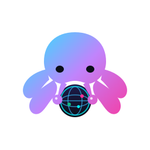

#  Руководство по участию в разработке (Contributing to Obxodka)

Спасибо за интерес к развитию проекта **Obxodka**! Мы открыты к любому конструктивному вкладу: от отчётов об ошибках и диагностики провайдерских блокировок в РФ до оптимизации сетевого ядра, UI и документации.

---

##  Требования для локальной разработки

- **.NET 10 SDK** (версия 10.0.100 или новее)
- **Visual Studio 2026 / Rider / VS Code** с поддержкой C# и .NET MAUI
- Установленные рабочие нагрузки MAUI: `maui-windows`, `maui-android`

```powershell
# Установка необходимых рабочих нагрузок MAUI
dotnet workload install maui-windows maui-android
```

---

##  Процесс разработки и сборки (Workflow)

1. **Форкните** репозиторий [`OctoCore-Dev/obxodka`](https://github.com/OctoCore-Dev/obxodka) на GitHub.
2. Создайте свою ветку строго от **`develop`**:
   ```bash
   git checkout -b fix/my-improvement
   ```
3. Соберите нужную цель:
   ```powershell
   # Сборка MAUI клиента под Windows
   dotnet build src/apps/obxodka.Maui/obxodka.Maui.csproj -f net10.0-windows10.0.19041.0 -c Release

   # Сборка MAUI клиента под Android
   dotnet build src/apps/obxodka.Maui/obxodka.Maui.csproj -f net10.0-android -c Release

   # Сборка ядра и тестов (или всего решения obxodka.slnx)
   dotnet build obxodka.slnx -c Release
   ```
4. Запустите автономные модульные тесты (не требуют живого VPN-сервера и Appium UI):
   ```powershell
   dotnet test tests/obxodka.Client.Tests/obxodka.Client.Tests.csproj -c Release --filter "Category!=Integration&Category!=UI&Category!=WireLevel"
   ```
   _Все 500+ тестов ядра и wire-level стенда (505 тестов с локальным loopback) должны проходить с **0 warnings, 0 errors**._
5. Проверьте требования к коду:
   - Никаких секретов, токенов, `.pfx` или приватных IP в диффе.
   - Без блокирующих `.Result` / `.Wait()` в асинхронных путях; статические приватные поля с префиксом `s_camelCase` (`t_` только для `[ThreadStatic]`).
   - В горячих путях пакетов используйте пулы (`ArrayPool<byte>.Shared`) и `Span<byte>` без лишних аллокаций.
6. Закоммитьте изменения в формате Conventional Commits и откройте **Pull Request** в ветку **`develop`**.

---

##  Лицензия, бренд и права на вклад (AGPLv3 + Trademark Policy)

* Клиентский код распространяется по открытой лицензии **[GNU Affero General Public License v3.0 (AGPLv3)](../LICENSE)**.
* Направляя Pull Request в `OctoCore-Dev/obxodka`, вы подтверждаете, что имеете право передать предложенный код под лицензией **GNU AGPLv3** для включения в официальный репозиторий и официальные релизы Obxodka (включая публикации в Google Play, Microsoft Store и GitHub Releases).
* Наименования **Obxodka / OctoCore**, логотипы и идентификаторы пакетов защищены **[TRADEMARK.md](../TRADEMARK.md)**: сторонние сборки обязаны сохранять открытый код под AGPLv3, но не имеют права использовать официальный бренд.

---

##  Сообщения об ошибках (Issues)

Если вы обнаружили баг или блокировку на конкретном провайдере РФ:

1. Проверьте существующие [Issues](https://github.com/OctoCore-Dev/obxodka/issues).
2. Создайте новый Issue по шаблону **Bug Report**, указав платформу, провайдера/регион и фрагмент лога подключения (**без JWT-токенов, email и паролей**).
3. Если нашли уязвимость безопасности — не открывайте публичный Issue, а напишите через **[Security Advisories](https://github.com/OctoCore-Dev/obxodka/security/advisories/new)** ([SECURITY.md](SECURITY.md)).

---

##  Связь с командой

- **Поддержка:** [GitHub Issues](https://github.com/OctoCore-Dev/obxodka/issues)
- **Релизы:** [GitHub Releases](https://github.com/OctoCore-Dev/obxodka/releases)
- **Обсуждения:** [GitHub Discussions](https://github.com/OctoCore-Dev/obxodka/discussions)
