<p align="center">
  <a href="https://obxodka.one">
    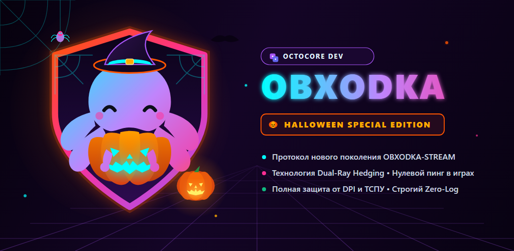
  </a>
</p>

<p align="center">
  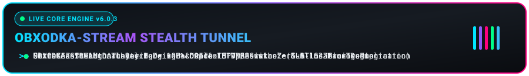
</p>

<div align="center">

#  Obxodka VPN Client

### *Стелс-VPN нового поколения с протоколом OBXODKA-STREAM и технологией Dual-Ray Hedging для Windows и Android.*

> **Абсолютная сетевая свобода • Устойчивость к DPI и ТСПУ • Нулевой пинг в играх • Строгий Zero-Log**

<br/>

<!-- Store & Action Badges -->
<a href="https://github.com/OctoCore-Dev/obxodka/releases"></a>
<a href="https://github.com/OctoCore-Dev/obxodka/actions"></a>
<a href="https://play.google.com/store/apps/details?id=com.octocore.obxodka"></a>
<a href="https://apps.microsoft.com/store/detail/9NZXP5WR803J"></a>
<a href="https://obxodka.one/Reviews"></a>
<a href="https://obxodka.one"></a>

<br/><br/>

<!-- Tech Stack Badges -->
[](https://dotnet.microsoft.com/)
[](https://learn.microsoft.com/dotnet/csharp/)
[](docs/ARCHITECTURE.md)
[](PRIVACY_POLICY.md)
[](TERMS_OF_SERVICE.md)
[](https://www.wintun.net/)
[](LICENSE)

</div>

<br/>

<p align="center">
  
</p>

---

##  Почему Obxodka?

Традиционные VPN-протоколы (WireGuard, OpenVPN, IPsec) используют фиксированные порты и узнаваемые заголовки пакетов, которые мгновенно распознаются и блокируются государственными и магистральными системами глубокого анализа пакетов (**DPI / ТСПУ**).

**Obxodka** решает эту задачу фундаментально через проприетарный высокоскоростной движок **OBXODKA-STREAM**:

<table>
  <tr>
    <td width="50%" valign="top">
      <h3>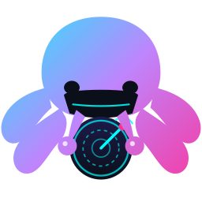 1. Кристальная маскировка под Web</h3>
      <p>Трафик инкапсулируется в полнодуплексные потоки <b>HTTP/2 поверх TLS 1.3</b> (порты <code>443</code>, <code>8443</code>, <code>2053</code>) с генерацией <b>3.4M+ динамических поддоменов</b>, 3-этапным расщеплением <code>ClientHello</code> в <code>DpiBypassStream</code> и имитационными запросами Early Decoy (<code>GET /</code>, <code>GET /favicon.ico</code>). Для цензуры сессия неотличима от браузера Chrome.</p>
    </td>
    <td width="50%" valign="top">
      <h3> 2. Dual-Ray Hedging для гейминга</h3>
      <p>Параллельное открытие двух независимых TCP-лучей (<code>Ray 0</code> и <code>Ray 1</code>). Критичные игровые пакеты UDP и ICMP-пинги <b>клонируются по обоим лучам</b>. Аппаратный <code>PacketDeduplicator</code> (скользящее окно 500 мс) на лету отбрасывает дубли с 0 аллокаций. Пакетлосс и джиттер полностью ликвидированы!</p>
    </td>
  </tr>
  <tr>
    <td width="50%" valign="top">
      <h3> 3. 500ms Sub-Second Probing</h3>
      <p>Высокочастотное зондирование задержки каждые 500 мс гарантирует моментальную калибровку RTT, удерживает сотовые NAT-таблицы живыми и исключает зависание видеопотоков 4K/8K при переходе между вышками связи.</p>
    </td>
    <td width="50%" valign="top">
      <h3> 4. Zero-Flicker Disconnect</h3>
      <p>Бесшовное отключение туннеля не сбрасывает сетевой стек Windows и не дергает адаптеры. При отключении физический интернет не «моргает», а локальные приложения, игры и Discord продолжают работать без разрыва сокетов.</p>
    </td>
  </tr>
  <tr>
    <td colspan="2" valign="top">
      <h3>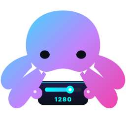 5. Адаптивный MTU и обход «Черных дыр» ТСПУ</h3>
      <p>Безопасный базовый MTU 1280 байт с динамическим зондированием (1200–1440 байт) и серверным TCPMSS Clamping (1240 байт) гарантируют мгновенное открытие тяжелых сайтов и стримов без фрагментации на мобильных операторах (МТС, МегаФон, Билайн, Т2, Yota).</p>
    </td>
  </tr>
</table>

---

##  Архитектура конвейера OBXODKA-STREAM

Сетевой трафик проходит через оптимизированный сквозной конвейер, устойчивый к блокировкам DPI:

* **Клиентский уровень (Windows / Android):** Перехват пакетов на сетевом уровне Layer 3 через высокоскоростной драйвер Wintun или Android VpnService. Модуль `PacketRouter` выполняет интеллектуальную маршрутизацию и клонирование приоритетных пакетов (UDP Gaming и ICMP-пинги).
* **Стелс-транспорт Dual-Ray:** Данные инкапсулируются в два параллельных независимых потока HTTP/2 (порты `443`, `8443` и `2053`) поверх TLS 1.3. Модуль `DpiBypassStream` выполняет сегментацию `ClientHello` и ротацию доменов (3.4M+ SNI), маскируя туннель под легитимный пользовательский веб-серфинг.
* **Серверный кластер Obxodka Node:** Прием потоков через `ObxodkaTunnelEndpoint`, субмиллисекундная дедупликация пакетов на кольцевом буфере в оперативной памяти (`PacketDeduplicator`, zero-allocation) и маршрутизация в открытый интернет через интерфейс `tun0`.

---

## 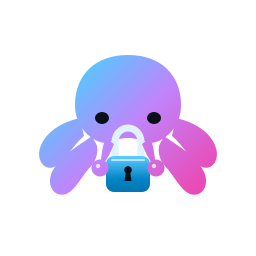 Взаимная авторизация mTLS Zero-Trust

Полный отказ от статических логинов и паролей на сетевых портах в пользу криптографической аутентификации:

* **Динамические сессионные сертификаты:** При входе в систему клиент получает уникальный зашифрованный `.pfx`-сертификат через защищенный API-шлюз.
* **Взаимная верификация (mTLS Handshake):** При каждом подключении клиент и сервер взаимно проверяют криптографические сертификаты и SPKI-хэши публичных ключей, полностью исключая атаки перехвата (MITM) и неавторизованный доступ.
* **Эфемерная безопасность:** Сессионные ключи шифрования хранятся исключительно в оперативной памяти (RAM-Only) и безвозвратно уничтожаются сразу после завершения сетевой сессии.

---

##  Сравнение протоколов и технологий

| Протокол / Технология | Устойчивость к DPI / ТСПУ | Скорость и игровой пинг | Шифрование сессии | Мультиплексирование | Защита от блокировок |
| :--- | :---: | :---: | :---: | :---: | :---: |
|  **Obxodka (OBXODKA-STREAM)** |  **100% (Не детектируется)** |  **< 1ms задержка (Dual-Ray)** |  **TLS 1.3 + AES-256-GCM** | **Dual-Ray Duplex HTTP/2** | **Максимальная** |
| **WireGuard** |  0% (Блокируется по UDP) | Высокая (но уязвим к дропу) | ChaCha20-Poly1305 | Нет | Блокируется |
| **OpenVPN** |  10% (Легко детектируется) | Низкая (TAP Overhead) | TLS / AES-CBC | Нет | Блокируется |
| **Shadowsocks / VLESS** |  60% (Частично блокируется) | Высокая | AEAD / TLS | Ограничено | Частичная |

---

##  Интеллектуальный защитный контур (Smart Shield Engine)

В **Obxodka** интегрирован передовой комплекс аппаратной защиты от телеметрии, слежки и утечек трафика:

* 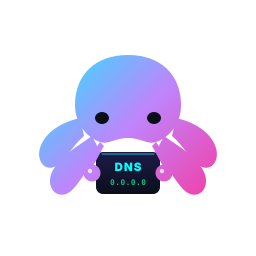 **Аппаратный L3 DNS Sinkhole (Windows & Android):** Встроенный в драйвер Wintun и TUN-ядро фильтр. Все попытки фоновой телеметрии (`AppMetrica`, `Yandex Metrika`, `VK Stats`, `Mail.ru`, аналитика банков, трекеры `AppsFlyer` / `Adjust`) перехватываются на сетевом уровне L3 и за **`0.05 мс` гасятся ответом `0.0.0.0`**. Шпионский пакет физически не покидает оперативную память.
*  **Happy Eyeballs & Latency Scoring:** Параллельное неблокирующее зондирование узлов кластера при подключении. Клиент автоматически выбирает сервер с минимальным RTT и наименьшей нагрузкой.
*  **Multi-Stage TLS Splitting:** Динамическое расщепление первого сегмента TLS ClientHello на 1–5 байт с паузой 15–35 мс и фрагментацией тела пакета. DPI не может распознать сигнатуру рукопожатия.
*  **Zero-Handoff Seamless Switching:** Бесшовное переключение серверов и сетевой роуминг (Wi-Fi ↔ LTE) без сброса TCP-соединений и потери пакетов.
*  **Защита от утечек DNS (NRPT & Auto-Heal):** Принудительная изоляция через таблицу политик разрешения имен Windows (NRPT), сброс кэша резолвера и авто-восстановление системных DNS-адаптеров.
*  **Smart App Cloaking (Android):** Автоматическая изоляция отечественных банков, Госуслуг и сервисов (`AddDisallowedApplication`). Система Android рапортует приложениям: **`TRANSPORT_VPN: FALSE`** — банковские переводы работают без блокировок.
*  **Hardware Kill-Switch:** Принудительная блокировка утечек IPv6 (`fd00::/8`), изоляция портов WebRTC/STUN (`3478` / `5349`) и аппаратная блокировка пакетов при разрывах связи.

---

##  Галерея интерфейса

<p align="center">
  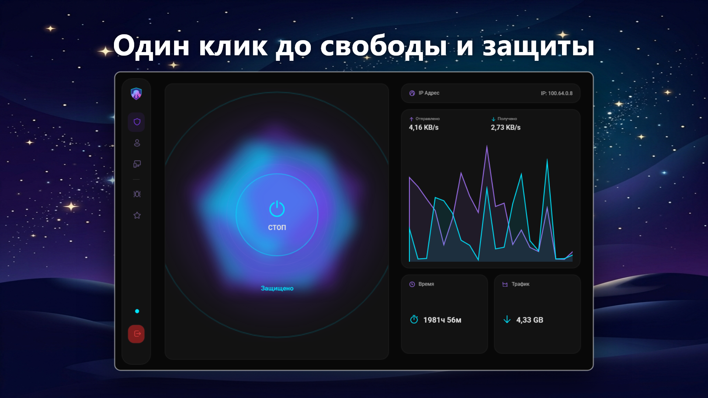
  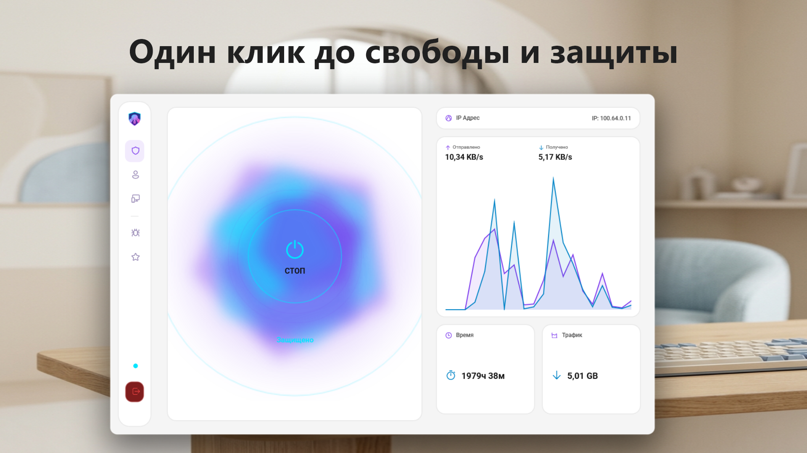
</p>
<p align="center">
  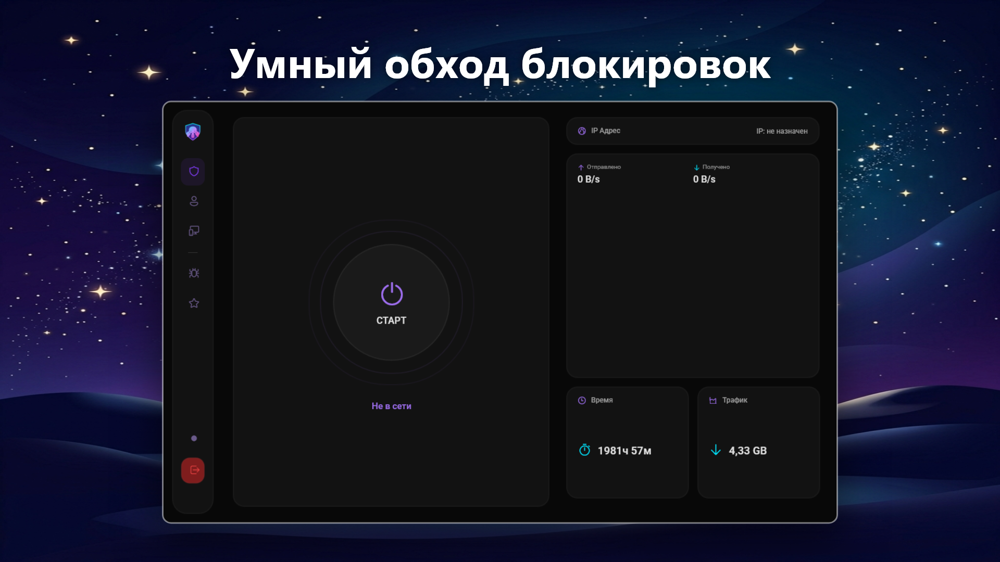
  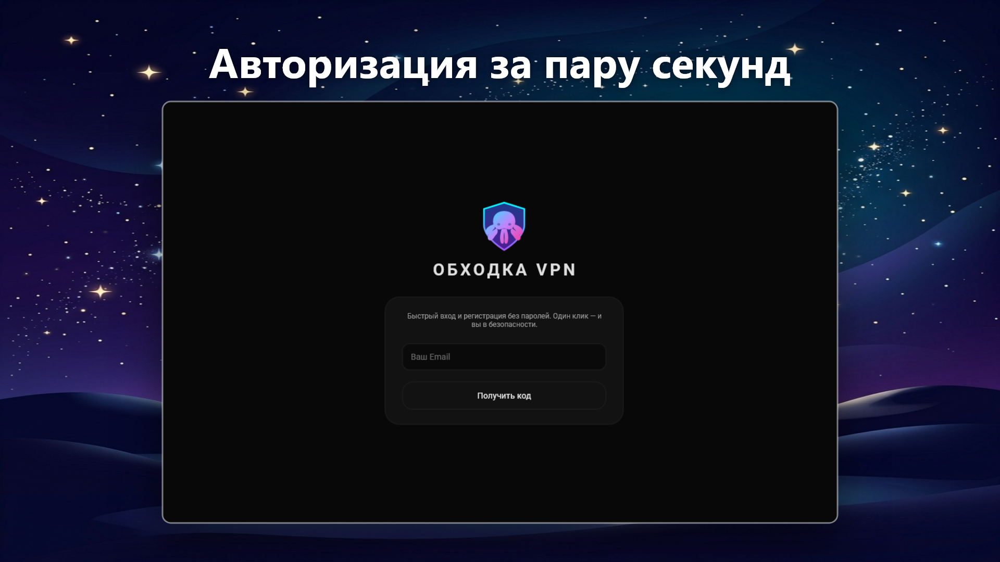
</p>

---

##  Дорожная карта развития (Roadmap 2026)

- [x] **Релиз клиента для Android** в [Google Play Store](https://play.google.com/store/apps/details?id=com.octocore.obxodka)
- [x] **Релиз клиента для Windows 10/11** в [Microsoft Store](https://apps.microsoft.com/store/detail/9NZXP5WR803J)
- [x] **Движок Octopus:** Wintun Layer 3 + OBXODKA-STREAM (HTTP/2 duplex)
- [x] **Dual-Ray Hedging:** Удвоение игрового трафика и пингов с zero-allocation дедупликацией
- [x] **Zero-Flicker Disconnect:** Бесшовное отключение туннеля без сброса сетевого стека Windows
- [x] **Автоматическая синхронизация отзывов:** Google Play + Microsoft Store на сайте [obxodka.one/Reviews](https://obxodka.one/Reviews)
- [x] **CI/CD Авто-деплой:** непрерывная сборка и публикация в магазины через GitHub Actions
- [x] **Встроенный AdBlock & Anti-Phishing фильтр на уровне DNS**
- [ ] **Разработка клиентов под iOS и macOS**

---

##  Часто задаваемые вопросы (FAQ)

<details>
<summary><b>Почему Obxodka не блокируется, когда блокируют другие VPN?</b></summary>
<br/>

Большинство обычных VPN используют протоколы с фиксированными сигнатурами (WireGuard handshake, OpenVPN TLS handshake). Системы DPI легко видят такие пакеты и сбрасывают соединение. **Obxodka** инкапсулирует трафик в проприетарные дуплексные HTTP/2 потоки поверх TLS 1.3 на портах 443, 8443 и 2053 с генерацией динамических поддоменов (3.4M+ SNI), 3-этапным расщеплением ClientHello в `DpiBypassStream` и ранней имитацией браузерных запросов Early Decoy — для любого провайдера это выглядит как стандартный защищенный просмотр веб-сайтов через Google Chrome.

</details>

<details>
<summary><b>Как Dual-Ray Hedging решает проблему пинга и потерь пакетов в онлайн-играх?</b></summary>
<br/>

В обычных VPN трафик идет по одному соединению. Если провайдер кратковременно теряет пакет (джиттер/дроп на узле ТСПУ), игра зависает или телепортирует персонажа. В Obxodka технология **Dual-Ray Hedging** клонирует каждый игровой UDP-пакет и ICMP-пинг в два независимых физических TCP-луча (`Ray 0` и `Ray 1`). Сервер и клиент принимают тот пакет, который пришел быстрее, а дубликат мгновенно отбрасывается `PacketDeduplicator`. В результате пинг остается идеально ровным даже при нестабильном интернете.

</details>

<details>
<summary><b>Ведёт ли Obxodka логи посещений (Logs)?</b></summary>
<br/>

**Категорически нет.** Вся архитектура построена по принципу Zero-Log. Серверы не хранят историю посещенных сайтов, IP-адреса назначения или DNS-запросы. Трафик проходит через оперативную память в зашифрованном виде и мгновенно уничтожается. Подробнее читайте в [Политике конфиденциальности](PRIVACY_POLICY.md).

</details>

<details>
<summary><b>Как собрать проект из исходников самостоятельно?</b></summary>
<br/>

```powershell
# 1. Клонирование репозитория
git clone https://github.com/OctoCore-Dev/obxodka.git
cd obxodka

# 2. Установка рабочих нагрузок .NET MAUI
dotnet workload install maui-windows maui-android

# 3. Сборка клиента под Windows
dotnet build src/apps/obxodka.Maui/obxodka.Maui.csproj -f net10.0-windows10.0.19041.0 -c Release

# 4. Запуск модульных тестов
dotnet test tests/obxodka.Client.Tests/obxodka.Client.Tests.csproj
```

</details>

---

## 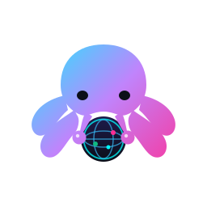 Сообщество, правовая информация и контакты

<table>
  <tr>
    <td width="50%">
      <b>Ресурсы и портал</b>
      <ul>
        <li> <b>Официальный сайт:</b> <a href="https://obxodka.one">obxodka.one</a></li>
        <li> <b>Архитектура ядра:</b> <a href="docs/ARCHITECTURE.md">docs/ARCHITECTURE.md</a></li>
        <li> <b>Диагностика:</b> <a href="docs/TROUBLESHOOTING.md">docs/TROUBLESHOOTING.md</a></li>
        <li> <b>Безопасность:</b> <a href=".github/SECURITY.md">.github/SECURITY.md</a></li>
      </ul>
    </td>
    <td width="50%">
      <b>Правовые положения и комплаенс</b>
      <ul>
        <li> <b>Политика конфиденциальности:</b> <a href="PRIVACY_POLICY.md">PRIVACY_POLICY.md</a></li>
        <li> <b>Условия использования:</b> <a href="TERMS_OF_SERVICE.md">TERMS_OF_SERVICE.md</a></li>
        <li> <b>Сообщить об ошибке:</b> <a href="https://github.com/OctoCore-Dev/obxodka/issues">GitHub Issues</a></li>
        <li> <b>Контакты поддержки:</b> <a href="mailto:contact@octocore.dev">contact@octocore.dev</a></li>
      </ul>
    </td>
  </tr>
</table>

---

<p align="center">
  <sub>Разработано командой <a href="https://github.com/OctoCore-Dev">OctoCore</a>. Лицензия <a href="LICENSE">Source-Available (OctoCore)</a>.</sub>
</p>
