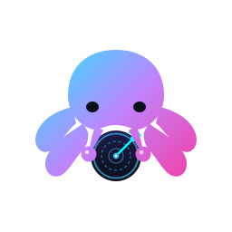
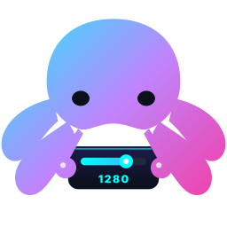
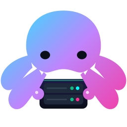
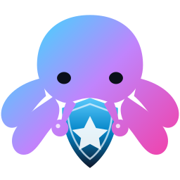
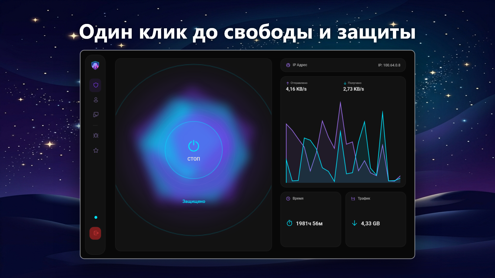

<p align="center">
  <a href="https://github.com/OctoCore-Dev/obxodka/releases">
    
  </a>
</p>

<p align="center">
  
</p>

<div align="center">

#  Obxodka VPN Client

### *Стелс-VPN нового поколения на .NET 11 с движком OBX-V9 Hydra, OBX-V8 Chameleon, XHTTP, Reality и WebSocket Shield для Windows, Android и Linux (GUI + CLI).*

> **Абсолютная сетевая свобода • Устойчивость к DPI и ТСПУ • Минимальный пинг • Строгий Zero-Log**

<br/>

<!-- Store & Action Badges -->
<a href="https://github.com/OctoCore-Dev/obxodka/releases"></a>
<a href="https://github.com/OctoCore-Dev/obxodka/stargazers"></a>
<a href="https://github.com/OctoCore-Dev/obxodka/releases"></a>
<a href="https://github.com/orgs/OctoCore-Dev/projects/1"></a>
<a href="https://github.com/OctoCore-Dev/obxodka/actions/workflows/release.yml"></a>
<a href="https://play.google.com/store/apps/details?id=com.octocore.obxodka"></a>
<a href="https://apps.microsoft.com/store/detail/9NZXP5WR803J"></a>
<a href="https://github.com/OctoCore-Dev/obxodka/actions/workflows/store-watchdog.yml"></a>
<a href="https://github.com/OctoCore-Dev/obxodka"></a>

<br/><br/>

<!-- Tech Stack Badges -->
[](https://dotnet.microsoft.com/)
[](https://learn.microsoft.com/dotnet/csharp/)
[](docs/CLI_AND_LINUX.md)
[](https://github.com/OctoCore-Dev/obxodka/actions/workflows/ci.yml)
[](https://github.com/OctoCore-Dev/obxodka/actions/workflows/codeql.yml)
[](PRIVACY_POLICY.md)
[](docs/ARCHITECTURE.md)
[](LICENSE)
[](TRADEMARK.md)

</div>

<br/>

<p align="center">
  
</p>

---

##  Быстрая установка (Windows, Android, Linux)

| Платформа | Клиент | Способ установки |
| :--- | :--- | :--- |
| **Windows 10 / 11 (GUI)** | `obxodka.Maui` (WinUI 3) | [Microsoft Store](https://apps.microsoft.com/store/detail/9NZXP5WR803J) или `Obxodka-Setup.exe` / `.msixbundle` из [GitHub Releases](https://github.com/OctoCore-Dev/obxodka/releases/latest) |
| **Windows 10 / 11 (CLI)** | `obxodka.Cli` (`obx` / `obxodka`) | `winget install OctoCore.Obxodka.Cli` или `obxodka-cli-win-x64.zip` из Releases |
| **Android 11+ (API 30+)** | `obxodka.Maui` + Quick Settings Tile | [Google Play Store](https://play.google.com/store/apps/details?id=com.octocore.obxodka) или `Obxodka-Android.apk` из Releases |
| **Linux (CLI + Avalonia GUI)** | `obxodka` (`obx`) + `obxodka-desktop` | `apt` (Debian/Ubuntu), `dnf` (Fedora), `pacman` (Arch) или однострочник `install.sh` ниже |

### Windows CLI (`winget`)
```powershell
winget install OctoCore.Obxodka.Cli
obx login
obx connect --adblock --kill-switch
```

### Linux (Debian / Ubuntu / Fedora / Arch / openSUSE)
```bash
# Установить CLI (obxodka + obx + systemd-служба + bash/zsh автодополнение)
curl -fsSL https://pkg.obxodka.one/install.sh | sudo sh

# Установить CLI + графический клиент Avalonia Desktop (obxodka-desktop)
curl -fsSL https://pkg.obxodka.one/install.sh | sudo sh -s -- --all

# Установить только Avalonia Desktop GUI
curl -fsSL https://pkg.obxodka.one/install.sh | sudo sh -s -- --desktop
```

> Подробные команды для ручного подключения **APT**, **DNF**, **Pacman**, настройки `systemd`, **Avalonia Desktop** и полный справочник команд `obx` смотрите в **[docs/CLI_AND_LINUX.md](docs/CLI_AND_LINUX.md)**.

---

##  Почему Obxodka?

Традиционные VPN-протоколы (WireGuard, OpenVPN, IPsec) используют фиксированные порты и узнаваемые заголовки пакетов, которые мгновенно
распознаются и блокируются государственными и магистральными системами глубокого анализа пакетов (**DPI / ТСПУ**).

**Obxodka** решает эту задачу через многоуровневый стелс-конвейер **Octopus Core (OBX-V9 Hydra / OBX-V8 Chameleon)**:

<table>
  <tr>
    <td width="50%" valign="top">
      <h3> 1. Мульти-транспорт OBX-V9 Hydra / XHTTP / WS</h3>
      <p>Клиент объединяет три современных транспорта с автоматической ротацией без пересоздания TUN-адаптера: прямой <b>OBX-V9 Hydra / Reality</b> (карусель сокетов &lt;12 KB и 24 KB анти-фриз против TCP-лимитов ТСПУ), асимметричный <b>OBXODKA-XHTTP</b> (разделённые HTTP/2 потоки) и облачный <b>OBXODKA-WS</b> через Cloudflare Shield с бесшовной эскалацией <code>TryEscalateToShieldAsync</code>.</p>
    </td>
    <td width="50%" valign="top">
      <h3> 2. OBX-V8 Chameleon и анти-ИИ морфинг</h3>
      <p>Модуль <b>Chameleon</b> вместе с <code>CleanEdgeScanner</code> подбирает чистые маршруты и маскирует профиль трафика (длины пакетов, интервалы, TLS ClientHello без дублей GREASE), усложняя ML-классификацию на узлах ТСПУ и удерживая стабильный пинг в играх.</p>
    </td>
  </tr>
  <tr>
    <td width="50%" valign="top">
      <h3> 3. Адаптивная сегментация ClientHello</h3>
      <p>Модуль <code>DpiBypassStream</code> совместно с <code>RoutingHello</code> выбирает браузерный TLS-профиль и применяет нарезку первого пакета <code>ClientHello</code> (<code>PureL4Midsld</code>, <code>TlsRecordMidsld</code>, <code>MultiRecordMidsld</code>) с микро-джиттером.</p>
    </td>
    <td width="50%" valign="top">
      <h3> 4. Zero-Flicker Disconnect &amp; Android Tile</h3>
      <p>Плавное снятие <code>/1</code> супернет-маршрутов на Windows и Linux без сброса физического адаптера, а на Android — автономная плитка <b>Quick Settings</b> (запуск с первого клика на холодном старте) и голосовое управление Gemini / Bixby.</p>
    </td>
  </tr>
  <tr>
    <td colspan="2" valign="top">
      <h3> 5. Адаптивный MTU, Split Tunneling и L3 DNS AdBlock</h3>
      <p>Внутритуннельное зондирование MTU, серверный TCPMSS Clamping, гибкое раздельное туннелирование (по приложениям и доменам) и встроенный L3 <code>DnsAdBlocker</code> обеспечивают работу без «чёрных дыр» и залипания HTTPS-сессий на Windows, Linux и Android.</p>
    </td>
  </tr>
</table>

---

##  Архитектура конвейера Obxodka

Все клиенты (`obxodka.Maui`, `obxodka.Avalonia`, `obxodka.Cli`) используют **единое сетевое ядро `OctopusEngine`** (строгий Single Source of Truth):

* **Платформенные адаптеры (Windows / Linux / Android):** Перехват Layer 3 пакетов через драйвер **Wintun** (64 MB ring buffer) на Windows, нативный **`/dev/net/tun` (`tun0`)** с `CAP_NET_ADMIN` на Linux и **`VpnService` (FGS)** на Android с поддержкой Split Tunneling и исключением банковских/государственных приложений.
* **Маршрутизация и приоритеты:** `PacketRouter` распределяет трафик по `PriorityPacketQueue` (приоритет DNS, TCP SYN/ACK, игрового UDP и ICMP) без лишних аллокаций (`ArrayPool<byte>` / `Span<byte>`).
* **Конвейер транспортов (`ProtocolPipeline`):** Единый реестр протоколов `AUTO` → **Reality / OBX-V9 Hydra** → **XHTTP** → **WebSocket Shield**. При обнаружении блокировки даунлинка (`TX > 0, RX = 0`) инспектор `OctopusEngine.TryEscalateToShieldAsync` на лету переключает транспорт на облачный **WebSocket Shield** без обрыва TUN-интерфейса.

---

##  Взаимная аутентификация mTLS и DoH Anti-Poison

* **Сессионные сертификаты mTLS:** При входе клиент получает персональный `.pfx`-сертификат устройства и предъявляет его при установлении туннеля.
* **Проверка открытых ключей (SPKI Pinning):** При прямых подключениях к серверам `CertificateValidator` сверяет SHA-256 хэш публичного ключа сервера с эталоном (без устаревшего SHA-1), предотвращая MITM-подмену.
* **DoH-резолвинг:** `ApiService` проверяет домены через шифрованные DoH-резолверы, отсеивая поддельные bogon/sinkhole-ответы провайдеров.

---

##  Сравнение протоколов в условиях жёсткого DPI

| Протокол / Подход | Маскировка под HTTPS | Резервный CDN Shield | Анти-фриз / Карусель ТСПУ | Шифрование / Аутентификация |
| :--- | :---: | :---: | :---: | :---: |
|  **Obxodka (`Hydra/Reality` + `XHTTP` + `WS`)** | TLS 1.3 + Chameleon + `DpiBypassStream` | Авто-эскалация на Cloudflare WSS | Карусель сокетов `<12 KB` + 24 KB анти-фриз | TLS 1.3 + mTLS `.pfx` + SPKI SHA-256 Pinning |
| **Классический WireGuard** | Нет (сигнатура UDP-хендшейка) | Нет | Нет | Noise_IK / статические ключи |
| **OpenVPN (TCP/UDP)** | Частичная (распознаётся по TLS-фреймам) | Нет | Нет | TLS / OpenVPN Data Channel |
| **Shadowsocks / VLESS** | Зависит от транспорта (WS / Reality) | Опционально (CDN) | Зависит от клиента | AEAD / XTLS-TLS |

---

##  Интеллектуальный защитный контур (Smart Shield Engine)

*  **Аппаратный L3 DNS Sinkhole (Windows, Linux & Android):** Встроенный в TUN-конвейер фильтр мгновенно гасит фоновую телеметрию и трекеры ответом `0.0.0.0` без выхода пакета в сеть.
*  **Happy Eyeballs & CleanEdgeScanner:** Параллельное неблокирующее зондирование узлов кластера и чистых edge-маршрутов с выбором сервера с минимальным RTT.
*  **Multi-Stage TLS Splitting:** Динамическое расщепление первого сегмента TLS ClientHello с браузерными профилями.
*  **Zero-Handoff Seamless Switching:** Бесшовное переключение серверов, транспортов и роуминг (Wi-Fi ↔ LTE) без сброса TUN-интерфейса.
*  **Защита от утечек DNS (NRPT / resolvectl & Auto-Heal):** Изоляция DNS на Windows через NRPT, на Linux через `resolvectl`/TUN DNS и авто-восстановление системных адаптеров.
*  **Smart App Cloaking (Android):** Автоматическая изоляция банков и госсервисов (`AddDisallowedApplication`) без конфликтов с проверкой VPN.
*  **Hardware Kill-Switch & Privacy:** Блокировка утечек IPv6 (`fd00::/8`), защита WebRTC от RU-STUN (`3478` / `5349`) и синхронизация часового пояса.

---

##  Галерея интерфейса

<p align="center">
  
  
</p>
<p align="center">
  
  
</p>

---

##  Дорожная карта развития (Roadmap 2026)

- [x] **Релиз клиента для Android** в [Google Play Store](https://play.google.com/store/apps/details?id=com.octocore.obxodka) + **Quick Settings Tile** и голосовые команды
- [x] **Релиз клиента для Windows 10/11** в [Microsoft Store](https://apps.microsoft.com/store/detail/9NZXP5WR803J)
- [x] **Переход на .NET 11 / C# 15** (Runtime Async, XAML SourceGen, SIMD, единый шаблон `dotnet-blueprint`)
- [x] **OBX-V9 Hydra & OBX-V8 Chameleon:** карусель сокетов `<12 KB`, 24 KB анти-фриз, CleanEdgeScanner, XHTTP, Reality, WebSocket Shield
- [x] **Кроссплатформенный CLI (`obxodka` / `obx`):** Windows PowerShell + Linux (`systemd`, bash/zsh completions, JSON API)
- [x] **Кроссплатформенный desktop-клиент (`obxodka.Avalonia`):** полноценный Linux GUI на едином ядре `obxodka.Client`
- [x] **Автосборка и публикация пакетов:** Winget (`OctoCore.Obxodka.Cli`) + подписанный Linux-репозиторий (`apt`, `dnf`, `pacman`)
- [x] **Каталог тем v4.1 (WCAG 2.1)** и аппаратный Single Canvas рендер (Hardware VSync)
- [ ] **Клиент под iOS / macOS**

---

##  Часто задаваемые вопросы (FAQ)

<details>
<summary><b>Почему клиент открыт под GNU AGPLv3 и можно ли собрать его самостоятельно?</b></summary>
<br/>

Мы открыли исходный код клиентского приложения под лицензией **[GNU AGPLv3](LICENSE)**, чтобы любой разработчик или исследователь
безопасности мог убедиться в отсутствии скрытой слежки и бэкдоров. Вы можете скомпилировать клиент самостоятельно из этого репозитория и пользоваться им через свой аккаунт **Obxodka**.

Форки и доработки приветствуются в виде **Pull Request** в ветку `develop`. Обратите внимание на **[TRADEMARK.md](TRADEMARK.md)**: сторонние
сборки обязаны сохранять лицензию AGPLv3 (открытый исходный код), но не имеют права использовать бренд **Obxodka / OctoCore**, логотипы и
официальные ID пакетов в сторах.

</details>

<details>
<summary><b>Как Obxodka обходит блокировки DPI / ТСПУ?</b></summary>
<br/>

**Obxodka** использует конвейер `ProtocolPipeline` без устаревших фиксированных сигнатур:
1. **OBX-V9 Hydra / Reality** с каруселью сокетов (`<12 KB`), 24 KB анти-фризом и `OBX-V8 Chameleon` (нарезка `ClientHello` в `DpiBypassStream` + анти-ИИ морфинг).
2. **OBXODKA-XHTTP** с разделёнными восходящим и нисходящим HTTP/2 потоками.
3. **OBXODKA-WS (Cloudflare Shield)** с автоматической эскалацией `TryEscalateToShieldAsync` при обнаружении фриза даунлинка (`TX > 0, RX = 0`) без обрыва TUN-интерфейса.

</details>

<details>
<summary><b>Ведёт ли Obxodka логи посещений (Logs)?</b></summary>
<br/>

**Нет.** Вся маршрутизация пакетов работает в оперативной памяти. Серверы не сохраняют историю посещённых сайтов, IP-адреса назначения или
DNS-запросы. Подробнее читайте в [Политике конфиденциальности](PRIVACY_POLICY.md).

</details>

<details>
<summary><b>Как собрать проект (MAUI, Avalonia, CLI) и запустить тесты из исходников?</b></summary>
<br/>

```powershell
# 1. Клонирование репозитория (требуется .NET 11 SDK из global.json)
git clone --recursive https://github.com/OctoCore-Dev/obxodka.git
cd obxodka

# 2. Сборка кроссплатформенного CLI (Windows / Linux)
dotnet build src/apps/obxodka.Cli/obxodka.Cli.csproj -c Release

# 3. Сборка Linux / Desktop GUI (Avalonia)
dotnet build src/apps/obxodka.Avalonia/obxodka.Avalonia.csproj -c Release

# 4. Сборка MAUI клиента под Windows / Android (требует workloads: maui-windows maui-android)
dotnet build src/apps/obxodka.Maui/obxodka.Maui.csproj -f net11.0-windows10.0.19041.0 -c Release
dotnet build src/apps/obxodka.Maui/obxodka.Maui.csproj -f net11.0-android -c Release

# 5. Запуск автономных модульных тестов (725+ тестов)
dotnet test tests/obxodka.Client.Tests/obxodka.Client.Tests.csproj -c Release --filter "Category!=Integration&Category!=UI&Category!=WireLevel"
```

Подробнее о структуре решения (`obxodka.slnx`), стандартах кода и отправке PR читайте в [.github/CONTRIBUTING.md](.github/CONTRIBUTING.md).

</details>

---

##  Статус умного деплоя (Smart Multi-Store & Package Pipeline)

Система релизов Obxodka автоматически собирает и распространяет клиенты сразу по всем каналам Windows, Android и Linux:

| Контур / Магазин | Пайплайн | Текущий статус | Механика работы |
| :--- | :--- | :---: | :--- |
| **Центральный релиз** | [`release.yml`](.github/workflows/release.yml) | [](https://github.com/OctoCore-Dev/obxodka/actions/workflows/release.yml) | Сборка Windows MSIX/EXE, Android AAB/APK, CLI ZIP, Linux DEB/RPM/Pacman (CLI + Avalonia), прогон 725+ xUnit тестов и GitHub Releases + `SHA256SUMS.txt`. |
| **Google Play Store** | `OctoPublisher (Android)` | [](https://play.google.com/store/apps/details?id=com.octocore.obxodka) | Автопубликация AAB в Google Play Console (Production). При модерации переводится в очередь `[QUEUED]`. |
| **Microsoft Store** | `OctoPublisher (Windows)` | [](https://apps.microsoft.com/store/detail/9NZXP5WR803J) | Автопубликация MSIX в Partner Center API. Если магазин на ревью (код 3) — ставит в очередь `[QUEUED]`. |
| **Windows Winget** | `winget-releaser (CLI)` |  | Автоматический PR с новой версией и SHA256 `obxodka-cli-win-x64.zip` (`obxodka` + `obx`) в `microsoft/winget-pkgs`. |
| **Linux Repo (APT/DNF/Pacman)** | `nFPM + GitHub Pages` | [](docs/CLI_AND_LINUX.md) | Подписанный GPG-репозиторий для `obxodka` (CLI) и `obxodka-desktop` (Avalonia) на `https://pkg.obxodka.one` + `install.sh`. |
| **Smart Store Watchdog** | [`store-watchdog.yml`](.github/workflows/store-watchdog.yml) | [](https://github.com/OctoCore-Dev/obxodka/actions/workflows/store-watchdog.yml) | Автономный фоновый сторож: отслеживает завершение проверки сторами и допушивает релиз из очереди. |

---

##  Сообщество, правовая информация и контакты

<table>
  <tr>
    <td width="50%">
      <b>Ресурсы и портал</b>
      <ul>
        <li> <b>Официальные релизы:</b> <a href="https://github.com/OctoCore-Dev/obxodka/releases">GitHub Releases</a></li>
        <li> <b>CLI и Linux (Avalonia / APT / DNF / Pacman / Winget):</b> <a href="docs/CLI_AND_LINUX.md">docs/CLI_AND_LINUX.md</a></li>
        <li> <b>История версий:</b> <a href="CHANGELOG.md">CHANGELOG.md</a></li>
        <li> <b>Архитектура ядра:</b> <a href="docs/ARCHITECTURE.md">docs/ARCHITECTURE.md</a></li>
        <li> <b>Диагностика:</b> <a href="docs/TROUBLESHOOTING.md">docs/TROUBLESHOOTING.md</a></li>
        <li> <b>Дайджест ТСПУ:</b> <a href="docs/BLOCKING_DIGEST.md">docs/BLOCKING_DIGEST.md</a></li>
        <li> <b>Безопасность:</b> <a href=".github/SECURITY.md">.github/SECURITY.md</a></li>
      </ul>
    </td>
    <td width="50%">
      <b>Правовые положения и комплаенс</b>
      <ul>
        <li> <b>Политика конфиденциальности:</b> <a href="PRIVACY_POLICY.md">PRIVACY_POLICY.md</a></li>
        <li> <b>Условия использования:</b> <a href="TERMS_OF_SERVICE.md">TERMS_OF_SERVICE.md</a></li>
        <li> <b>Товарные знаки и бренд:</b> <a href="TRADEMARK.md">TRADEMARK.md</a></li>
        <li> <b>Участие в разработке:</b> <a href=".github/CONTRIBUTING.md">.github/CONTRIBUTING.md</a></li>
        <li> <b>Поддержка и обсуждения:</b> <a href="https://github.com/OctoCore-Dev/obxodka/discussions">GitHub Discussions</a></li>
      </ul>
    </td>
  </tr>
</table>

---

<p align="center">
  <sub>Разработано командой <a href="https://github.com/OctoCore-Dev">OctoCore</a>. Лицензия кода <a href="LICENSE">GNU AGPLv3</a> • Правила бренда <a href="TRADEMARK.md">TRADEMARK.md</a>.</sub>
</p>
