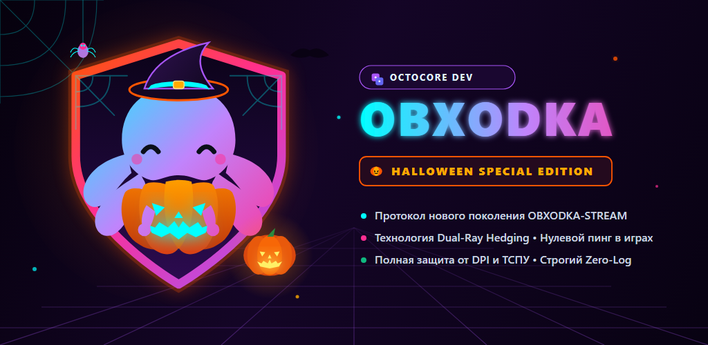
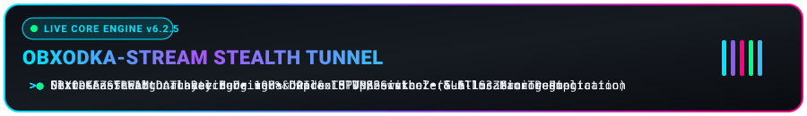
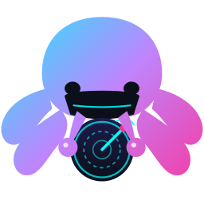
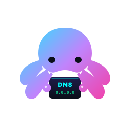
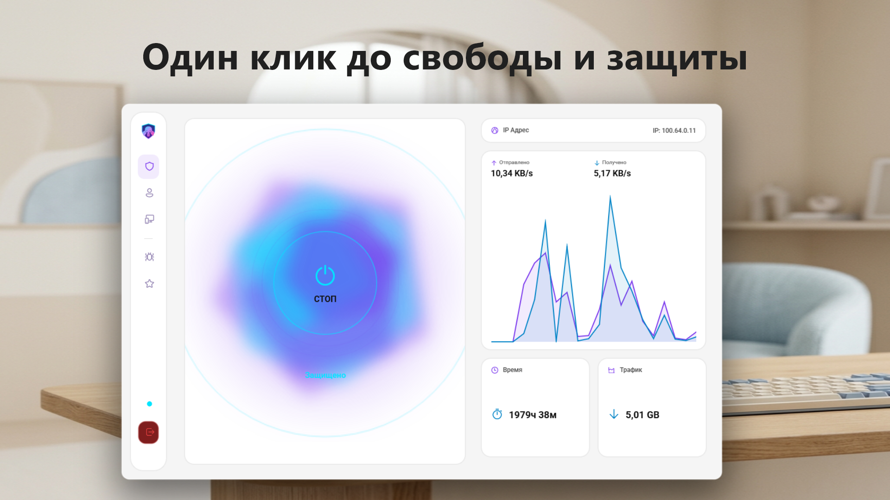
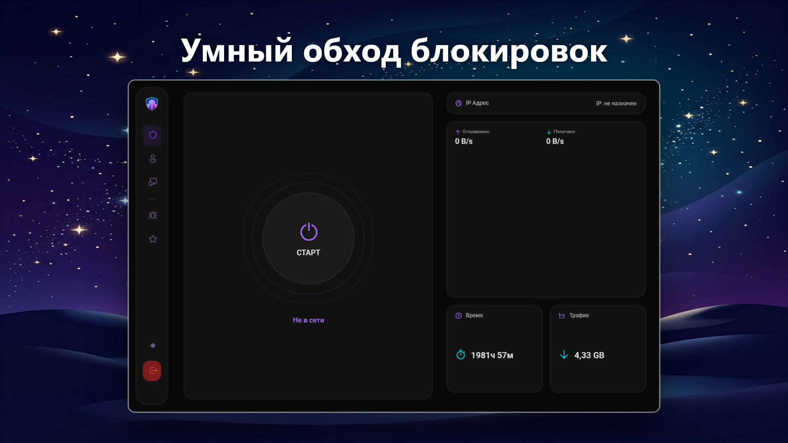
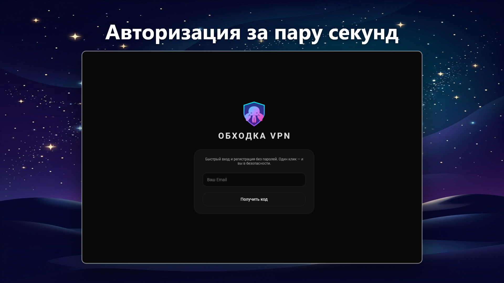
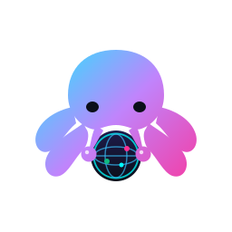

<p align="center">
  <a href="https://github.com/OctoCore-Dev/obxodka/releases">
    
  </a>
</p>

<p align="center">
  
</p>

<div align="center">

#  Obxodka VPN Client

### *Стелс-VPN нового поколения с протоколом OBXODKA-STREAM и технологией Dual-Ray Hedging для Windows и Android.*

> **Абсолютная сетевая свобода • Устойчивость к DPI и ТСПУ • Нулевой пинг в играх • Строгий Zero-Log**

<br/>

<!-- Store & Action Badges -->
<a href="https://github.com/OctoCore-Dev/obxodka/releases"></a>
<a href="https://github.com/OctoCore-Dev/obxodka/stargazers"></a>
<a href="https://github.com/OctoCore-Dev/obxodka/releases"></a>
<a href="https://github.com/orgs/OctoCore-Dev/projects/1"></a>
<a href="https://github.com/OctoCore-Dev/obxodka/actions/workflows/release.yml"></a>
<a href="https://play.google.com/store/apps/details?id=com.octocore.obxodka"></a>
<a href="https://apps.microsoft.com/store/detail/9NZXP5WR803J"></a>
<a href="https://github.com/OctoCore-Dev/obxodka/actions/workflows/store-watchdog.yml"></a>
<a href="https://github.com/OctoCore-Dev/obxodka"></a>

<br/><br/>

<!-- Tech Stack Badges -->
[](https://dotnet.microsoft.com/)
[](https://learn.microsoft.com/dotnet/csharp/)
[](https://github.com/OctoCore-Dev/obxodka/actions/workflows/ci.yml)
[](https://github.com/OctoCore-Dev/obxodka/actions/workflows/codeql.yml)
[](PRIVACY_POLICY.md)
[](https://www.wintun.net/)
[](LICENSE)
[](TRADEMARK.md)

</div>

<br/>

<p align="center">
  
</p>

---

##  Почему Obxodka?

Традиционные VPN-протоколы (WireGuard, OpenVPN, IPsec) используют фиксированные порты и узнаваемые заголовки пакетов, которые мгновенно
распознаются и блокируются государственными и магистральными системами глубокого анализа пакетов (**DPI / ТСПУ**).

**Obxodka** решает эту задачу фундаментально через проприетарный высокоскоростной движок **OBXODKA-STREAM**:

<table>
  <tr>
    <td width="50%" valign="top">
      <h3> 1. Гибридный транспорт под DPI / ТСПУ</h3>
      <p>Клиент сочетает два транспорта: прямой <b>OBXODKA-STREAM</b> (полнодуплексный HTTP/2 поверх TLS 1.3 на портах <code>443</code>, <code>8443</code>, <code>2053</code> в режиме Zero-SNI с жестким SSL Pinning) и резервный облачный <b>OBXODKA-WS</b> через Cloudflare Edge с ротацией зеркал и бесшовной эскалацией без пересоздания TUN-адаптера.</p>
    </td>
    <td width="50%" valign="top">
      <h3> 2. Dual-Ray Hedging для гейминга</h3>
      <p>В режиме <code>OBXODKA-STREAM</code> открываются два параллельных TCP-луча (<code>Ray 0</code> и <code>Ray 1</code>), а критичные UDP/ICMP-пакеты дублируются в оба луча. Кольцевой дедупликатор <code>PacketDeduplicator</code> без аллокаций отбрасывает запоздавшую копию и сглаживает импульсный джиттер.</p>
    </td>
  </tr>
  <tr>
    <td width="50%" valign="top">
      <h3> 3. Адаптивная сегментация ClientHello</h3>
      <p>Модуль <code>DpiBypassStream</code> совместно с <code>RoutingHello</code> выбирает браузерный TLS-профиль и применяет нарезку первого пакета <code>ClientHello</code> (<code>PureL4Midsld</code>, <code>TlsRecordMidsld</code>, <code>MultiRecordMidsld</code>) с микро-джиттером, усложняя сигнатурный разбор на ТСПУ.</p>
    </td>
    <td width="50%" valign="top">
      <h3> 4. Zero-Flicker Disconnect &amp; Probing</h3>
      <p>Плавное снятие <code>/1</code> супернет-маршрутов на Windows без сброса физического адаптера, адаптивное зондирование задержки и удержание NAT сотовых операторов на Android без «моргания» интернета у локальных программ и игр.</p>
    </td>
  </tr>
  <tr>
    <td colspan="2" valign="top">
      <h3> 5. Адаптивный MTU и защита от «чёрных дыр» ТСПУ</h3>
      <p>Внутритуннельное зондирование MTU, серверный TCPMSS Clamping и встроенный L3 <code>DnsAdBlocker</code> обеспечивают прохождение трафика на мобильных сетях и ШПД при каскадной инкапсуляции без «залипания» HTTPS-сессий.</p>
    </td>
  </tr>
</table>

---

##  Архитектура конвейера Obxodka

Сетевой трафик проходит через единый сквозной конвейер ядра `OctopusEngine`:

* **Платформенные адаптеры (Windows / Android):** Перехват Layer 3 пакетов через драйвер **Wintun** (64 MB ring buffer) на Windows и
  нативный `VpnService` на Android с поддержкой **Split Tunneling** и исключением банковских/государственных приложений.
* **Маршрутизация и приоритеты:** `PacketRouter` распределяет трафик по `PriorityPacketQueue` (приоритет DNS, TCP SYN/ACK, игрового UDP и
  ICMP) и при использовании `OBXODKA-STREAM` дублирует realtime-пакеты по `Ray 0` и `Ray 1`.
* **Защита от фризов ТСПУ:** При обнаружении блокировки даунлинка (`TX > 0, RX = 0`) инспектор `OctopusEngine.TryEscalateToShieldAsync` на
  лету переключает транспорт на облачный **WebSocket Shield** (`OBXODKA-WS`) без обрыва TUN-интерфейса.

---

##  Взаимная аутентификация mTLS и DoH Anti-Poison

* **Сессионные сертификаты mTLS:** При входе клиент получает персональный `.pfx`-сертификат устройства и предъявляет его при установлении
  туннеля.
* **Проверка открытых ключей (SPKI Pinning):** При прямых подключениях к серверам `CertificateValidator` сверяет SHA-256 хэш публичного
  ключа сервера с эталоном, предотвращая MITM-подмену даже при наличии сторонних корневых сертификатов.
* **DoH-резолвинг:** `ApiService` проверяет домены через шифрованные DoH-резолверы, отсеивая поддельные bogon/sinkhole-ответы провайдеров.

---

##  Сравнение протоколов в условиях жёсткого DPI

| Протокол / Подход                                                                                                                    |          Маскировка под HTTPS           |       Резервный CDN Shield       |     Обработка потерь UDP/ICMP     |     Шифрование / Аутентификация      |
|:-------------------------------------------------------------------------------------------------------------------------------------|:---------------------------------------:|:--------------------------------:|:---------------------------------:|:------------------------------------:|
|  **Obxodka (`OBXODKA-STREAM` + `WS`)** | HTTP/2 over TLS 1.3 + `DpiBypassStream` | Авто-эскалация на Cloudflare WSS | `Dual-Ray Hedging` + дедупликация | TLS 1.3 + mTLS `.pfx` + SPKI Pinning |
| **Классический WireGuard**                                                                                                           |      Нет (сигнатура UDP-хендшейка)      |               Нет                |        Одиночный UDP-поток        |     Noise_IK / статические ключи     |
| **OpenVPN (TCP/UDP)**                                                                                                                | Частичная (распознаётся по TLS-фреймам) |               Нет                |  Одиночный поток / TCP-over-TCP   |      TLS / OpenVPN Data Channel      |
| **Shadowsocks / VLESS**                                                                                                              |  Зависит от транспорта (WS / Reality)   |        Опционально (CDN)         |       Одиночное соединение        |           AEAD / XTLS-TLS            |

---

##  Интеллектуальный защитный контур (Smart Shield Engine)

В **Obxodka** интегрирован передовой комплекс аппаратной защиты от телеметрии, слежки и утечек трафика:

*  **Аппаратный L3 DNS Sinkhole (Windows &
  Android):** Встроенный в драйвер Wintun и TUN-ядро фильтр. Все попытки фоновой телеметрии (`AppMetrica`, `Yandex Metrika`, `VK Stats`,
  `Mail.ru`, аналитика банков, трекеры `AppsFlyer` / `Adjust`) перехватываются на сетевом уровне L3 и за **`0.05 мс` гасятся ответом
  `0.0.0.0`**. Шпионский пакет физически не покидает оперативную память.
*  **Happy Eyeballs & Latency Scoring:**
  Параллельное неблокирующее зондирование узлов кластера при подключении. Клиент автоматически выбирает сервер с минимальным RTT и
  наименьшей нагрузкой.
*  **Multi-Stage TLS Splitting:**
  Динамическое расщепление первого сегмента TLS ClientHello на 1–5 байт с паузой 15–35 мс и фрагментацией тела пакета. DPI не может
  распознать сигнатуру рукопожатия.
*  **Zero-Handoff Seamless Switching:**
  Бесшовное переключение серверов и сетевой роуминг (Wi-Fi ↔ LTE) без сброса TCP-соединений и потери пакетов.
*  **Защита от утечек DNS (NRPT &
  Auto-Heal):** Принудительная изоляция через таблицу политик разрешения имен Windows (NRPT), сброс кэша резолвера и авто-восстановление
  системных DNS-адаптеров.
*  **Smart App Cloaking (Android):**
  Автоматическая изоляция отечественных банков, Госуслуг и сервисов (`AddDisallowedApplication`). Система Android рапортует приложениям:
  **`TRANSPORT_VPN: FALSE`** — банковские переводы работают без блокировок.
*  **Hardware Kill-Switch:**
  Принудительная блокировка утечек IPv6 (`fd00::/8`), изоляция портов WebRTC/STUN (`3478` / `5349`) и аппаратная блокировка пакетов при
  разрывах связи.

---

##  Галерея интерфейса

<p align="center">
  
  
</p>
<p align="center">
  
  
</p>

---

##  Дорожная карта развития (Roadmap 2026)

- [x] **Релиз клиента для Android** в [Google Play Store](https://play.google.com/store/apps/details?id=com.octocore.obxodka)
- [x] **Релиз клиента для Windows 10/11** в [Microsoft Store](https://apps.microsoft.com/store/detail/9NZXP5WR803J)
- [x] **Движок Octopus:** Wintun Layer 3 + OBXODKA-STREAM (HTTP/2 duplex)
- [x] **Dual-Ray Hedging:** Удвоение игрового трафика и пингов с zero-allocation дедупликацией
- [x] **Zero-Flicker Disconnect:** Бесшовное отключение туннеля без сброса сетевого стека Windows
- [x] **Автоматическая синхронизация отзывов:** Google Play + Microsoft Store в единой экосистеме
- [x] **CI/CD Авто-деплой:** непрерывная сборка и публикация в магазины через GitHub Actions
- [x] **Встроенный AdBlock & Anti-Phishing фильтр на уровне DNS**
- [ ] **Кроссплатформенный desktop-клиент (`obxodka.Avalonia`, Linux / macOS)** *(UI-каркас в разработке)*
- [ ] **Клиент под iOS**

---

##  Часто задаваемые вопросы (FAQ)

<details>
<summary><b>Почему клиент открыт под GNU AGPLv3 и можно ли собрать его самостоятельно?</b></summary>
<br/>

Мы открыли исходный код клиентского приложения под лицензией **[GNU AGPLv3](LICENSE)**, чтобы любой разработчик или исследователь
безопасности мог убедиться в отсутствии скрытой слежки и бэкдоров. Если вы не доверяете готовым сборкам из магазинов приложений, вы можете
скомпилировать клиент самостоятельно из этого репозитория и пользоваться им через свой аккаунт **Obxodka** (с активной подпиской/балансом
времени).

Форки и доработки приветствуются в виде **Pull Request** в ветку `develop`. Обратите внимание на **[TRADEMARK.md](TRADEMARK.md)**: сторонние
сборки обязаны сохранять лицензию AGPLv3 (открытый исходный код), но не имеют права использовать бренд **Obxodka / OctoCore**, логотипы и
официальные ID пакетов в сторах.

</details>

<details>
<summary><b>Как Obxodka обходит блокировки DPI / ТСПУ?</b></summary>
<br/>

Обычные VPN используют протоколы с фиксированными сигнатурами (WireGuard, OpenVPN). **Obxodka** сочетает два режима: прямой
**OBXODKA-STREAM** (полнодуплексный HTTP/2 поверх TLS 1.3 на портах `443`, `8443`, `2053` в режиме Zero-SNI) с нарезкой `ClientHello` в
`DpiBypassStream` и облачный **OBXODKA-WS** через Cloudflare Shield с ротацией зеркал и автоматическим переключением
`TryEscalateToShieldAsync` при зависании канала.

</details>

<details>
<summary><b>Как Dual-Ray Hedging решает проблему пинга и потерь пакетов в онлайн-играх?</b></summary>
<br/>

В режиме `OBXODKA-STREAM` игровой UDP-трафик и ICMP-пинги клонируются в два параллельных TCP-луча (`Ray 0` и `Ray 1`). Принимающая сторона
забирает первый дошедший пакет, а дубликат мгновенно отбрасывается через `PacketDeduplicator` без аллокаций памяти. Это сглаживает
импульсные потери и джиттер на проблемных участках сети.

</details>

<details>
<summary><b>Ведёт ли Obxodka логи посещений (Logs)?</b></summary>
<br/>

**Нет.** Вся маршрутизация пакетов работает в оперативной памяти. Серверы не сохраняют историю посещённых сайтов, IP-адреса назначения или
DNS-запросы. Подробнее читайте в [Политике конфиденциальности](PRIVACY_POLICY.md).

</details>

<details>
<summary><b>Как собрать проект и запустить тесты из исходников самостоятельно?</b></summary>
<br/>

```powershell
# 1. Клонирование репозитория
git clone https://github.com/OctoCore-Dev/obxodka.git
cd obxodka

# 2. Установка рабочих нагрузок .NET MAUI
dotnet workload install maui-windows maui-android

# 3. Сборка клиента под Windows
dotnet build src/apps/obxodka.Maui/obxodka.Maui.csproj -f net10.0-windows10.0.19041.0 -c Release

# 4. Запуск автономных модульных тестов (без живого сервера и UI)
dotnet test tests/obxodka.Client.Tests/obxodka.Client.Tests.csproj -c Release --filter "Category!=Integration&Category!=UI&Category!=WireLevel"
```

Подробнее о структуре решений (`obxodka.slnx`), стандартах кода и отправке PR читайте в [.github/CONTRIBUTING.md](.github/CONTRIBUTING.md).

</details>

---

##  Статус умного деплоя (Smart Multi-Store Pipeline)

Система релизов Obxodka использует двухконтурный механизм умного деплоя (**Smart Store Deployer & Watchdog**), предотвращающий сбои сборки
при нахождении приложения на проверке:

| Контур / Магазин         | Пайплайн                                                     |                                                                                                                                      Текущий статус                                                                                                                                      | Механика работы                                                                                                            |
|:-------------------------|:-------------------------------------------------------------|:----------------------------------------------------------------------------------------------------------------------------------------------------------------------------------------------------------------------------------------------------------------------------------------:|:---------------------------------------------------------------------------------------------------------------------------|
| **Центральный релиз**    | [`release.yml`](.github/workflows/release.yml)               |      [](https://github.com/OctoCore-Dev/obxodka/actions/workflows/release.yml)      | Сборка Windows MSIX, Android AAB, прогон xUnit тестов (505 тестов) и публикация в GitHub Releases.                         |
| **Google Play Store**    | `OctoPublisher (Android)`                                    |               [](https://play.google.com/store/apps/details?id=com.octocore.obxodka)               | Автопубликация AAB в Google Play Console (Production). При модерации переводится в очередь `[QUEUED]`.                     |
| **Microsoft Store**      | `OctoPublisher (Windows)`                                    |                       [](https://apps.microsoft.com/store/detail/9NZXP5WR803J)                       | Автопубликация MSIX в Partner Center API. Если магазин на ревью (код 3) — не ломает сборку, а ставит в очередь `[QUEUED]`. |
| **Smart Store Watchdog** | [`store-watchdog.yml`](.github/workflows/store-watchdog.yml) | [](https://github.com/OctoCore-Dev/obxodka/actions/workflows/store-watchdog.yml) | Автономный фоновый сторож: циклически проверяет окончание проверки сторами и автоматически допушивает релиз из очереди.    |

---

##  Сообщество, правовая информация и контакты

<table>
  <tr>
    <td width="50%">
      <b>Ресурсы и портал</b>
      <ul>
        <li> <b>Официальные релизы:</b> <a href="https://github.com/OctoCore-Dev/obxodka/releases">GitHub Releases</a></li>
        <li> <b>История версий:</b> <a href="CHANGELOG.md">CHANGELOG.md</a></li>
        <li> <b>Архитектура ядра:</b> <a href="docs/ARCHITECTURE.md">docs/ARCHITECTURE.md</a></li>
        <li> <b>Диагностика:</b> <a href="docs/TROUBLESHOOTING.md">docs/TROUBLESHOOTING.md</a></li>
        <li> <b>Дайджест ТСПУ:</b> <a href="docs/BLOCKING_DIGEST.md">docs/BLOCKING_DIGEST.md</a></li>
        <li> <b>Безопасность:</b> <a href=".github/SECURITY.md">.github/SECURITY.md</a></li>
      </ul>
    </td>
    <td width="50%">
      <b>Правовые положения и комплаенс</b>
      <ul>
        <li> <b>Политика конфиденциальности:</b> <a href="PRIVACY_POLICY.md">PRIVACY_POLICY.md</a></li>
        <li> <b>Условия использования:</b> <a href="TERMS_OF_SERVICE.md">TERMS_OF_SERVICE.md</a></li>
        <li> <b>Товарные знаки и бренд:</b> <a href="TRADEMARK.md">TRADEMARK.md</a></li>
        <li> <b>Участие в разработке:</b> <a href=".github/CONTRIBUTING.md">CONTRIBUTING.md</a></li>
        <li> <b>Поддержка и обсуждения:</b> <a href="https://github.com/OctoCore-Dev/obxodka/discussions">GitHub Discussions</a></li>
      </ul>
    </td>
  </tr>
</table>

---

<p align="center">
  <sub>Разработано командой <a href="https://github.com/OctoCore-Dev">OctoCore</a>. Лицензия кода <a href="LICENSE">GNU AGPLv3</a> • Правила бренда <a href="TRADEMARK.md">TRADEMARK.md</a>.</sub>
</p>
