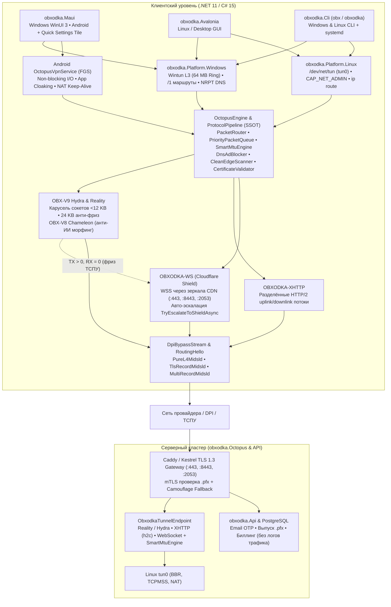

#  Архитектура и спецификация экосистемы Obxodka

Данный документ содержит полное техническое описание архитектуры клиентской и серверной частей **Obxodka (v6.4+ / .NET 11 / C# 15)** — кроссплатформенного стелс-VPN нового поколения для **Windows**, **Android** и **Linux** (GUI + CLI), разработанного для устойчивого обхода **DPI / ТСПУ** со строгой политикой **Zero-Log**.

---

##  Актуальная высокоуровневая архитектурная схема (v6.4+)



---

##  1. Клиентская подсистема (Client Architecture)

Принцип **Single Source of Truth (SSOT)**: платформенные адаптеры (`obxodka.Platform.Windows`, `obxodka.Platform.Linux`, Android `OctopusVpnService`) отвечают исключительно за взаимодействие с ОС (TUN-интерфейс, маршруты, DNS, уведомления). Все решения о выборе протоколов, портов, зеркал, ротации и эскалации принимает исключительно ядро `obxodka.Client` (`OctopusEngine` / `ProtocolPipeline`).

### 1.1. Клиентские приложения (Apps)
* **`obxodka.Maui` (Windows WinUI 3 & Android):** основное графическое приложение на .NET 11 MAUI с адаптивной вёрсткой (телефоны, Fold/Flip, планшеты, десктоп), Single Canvas рендером на Hardware VSync (`CompositionTarget.Rendering`), каталогом тем v4.1 (WCAG 2.1), плиткой Android Quick Settings Tile (холодный старт в 1 клик) и голосовым управлением Gemini / Bixby.
* **`obxodka.Avalonia` (`obxodka-desktop`):** полноценный кроссплатформенный desktop-клиент под Linux (пакеты `.deb`, `.rpm`, `.pkg.tar.zst`, `.tar.gz`), подключённый напрямую к ядру `obxodka.Client`.
* **`obxodka.Cli` (`obxodka` / `obx`):** консольный клиент с живым ANSI TUI, JSON-выводом, `systemd`-юнитом, автодополнением (`powershell`/`bash`/`zsh`) и распространением через **Winget** (`OctoCore.Obxodka.Cli`) и Linux-репозитории **APT / DNF / Pacman** (подробнее в [CLI_AND_LINUX.md](CLI_AND_LINUX.md)).

### 1.2. Платформенный уровень Windows (`obxodka.Platform.Windows`)
* **Драйвер Wintun (`WintunAdapter.cs`):** прямой P/Invoke к `wintun.dll` через `[LibraryImport]`, кольцевой буфер **64 МБ**, ожидание событий ядра Win32 без загрузки CPU и копирование пакетов через `ArrayPool<byte>.Shared` без лишних аллокаций.
* **Маршрутизация Supernetting `/1` (`WindowsVpnService.cs`):** добавляются маршруты `0.0.0.0/1` и `128.0.0.0/1` поверх шлюза `100.64.0.1` без разрушения системного `0.0.0.0/0`, плюс исключения для целевого узла, локальных подсетей (`10/8`, `172.16/12`, `192.168/16`) и активных RDP/удалённых сессий.
* **Zero-Flicker Disconnect:** при отключении аккуратно снимаются только добавленные маршруты и правила без сброса физического адаптера.
* **Защита от утечек DNS (NRPT & Auto-Heal):** правила `Add-DnsClientNrptRule`, блокировка утечек на 53 порт физических интерфейсов и авто-восстановление системного DNS.

### 1.3. Платформенный уровень Linux (`obxodka.Platform.Linux`)
* **Нативный TUN (`/dev/net/tun`):** создание L3-интерфейса `tun0` через `ioctl(TUNSETIFF)` и неблокирующий обмен пакетами с ядром Linux.
* **Минимальные привилегии (`CAP_NET_ADMIN`, `CAP_NET_RAW`):** при установке системных пакетов `.deb`/`.rpm`/`.pkg.tar.zst` бинарникам `obxodka` и `obxodka.Avalonia` выдаются capabilities через `setcap`, а `obxodka.service` запускается под `systemd` с `NoNewPrivileges=true`.
* **Маршрутизация и DNS:** настройка `/1` маршрутов через `ip route`, обход прямого IP сервера и интеграция DNS без поломки локального `systemd-resolved`.

### 1.4. Платформенный уровень Android (`OctopusVpnService`)
* Нативная служба `Android.Net.VpnService` (`ForegroundServiceType.TypeSpecialUse`), раздельные потоки чтения/записи `tun0`, адаптивный NAT Keep-Alive (500 мс на старте → 25 с в фоне), `Smart App Cloaking` (`AddDisallowedApplication` для банков и госсервисов) и автономный `Quick Settings Tile`.

### 1.5. Интеллектуальный поиск узлов (`Happy Eyeballs` & `CleanEdgeScanner`)
* Параллельный неблокирующий опрос узлов кластера с ранжированием по формуле:
  $$\text{Score} = \text{RTT}_{\text{ms}} + \frac{\text{LoadPercent}}{5}$$
* `CleanEdgeScanner` проверяет доступность чистых edge-маршрутов, а `ApiService` выполняет Anti-Poison DoH-резолвинг с отсевом подменённых bogon/sinkhole-ответов.

---

##  2. Конвейер стелс-транспортов и бинарный фрейминг

### 2.1. Спецификация бинарного кадра (`ObxodkaFraming`)
Каждый L3 IP-пакет и управляющая команда упаковываются в компактный бинарный фрейм с маскировкой заголовка и динамическим паддингом:

```text
+------------------+-------------------+-------------------+--------------------+------------------------+-------------------+
| Salt (1 байт)    | Total Length      | Payload Length    | Command Code       | Masked Payload         | Random Padding    |
| (0x00 - 0xFF)    | (2 байта, masked) | (2 байта, masked) | (1 байт, masked)   | (длина: Payload Length)| (динамический шум)|
+------------------+-------------------+-------------------+--------------------+------------------------+-------------------+
```

* **Команды управления:** `0x01` (`CmdData`), `0x02` (`CmdPing`), `0x03` (`CmdPong`), `0x04` (`CmdHandshake`), `0x05` (`CmdHandshakeResponse`), `0x06` (`CmdDisconnect`), `0x07` (`CmdMtuSync`).
* **Поточное маскирование нагрузки:**
  $$\text{Payload}[i] \leftarrow \text{Payload}[i] \oplus (\text{salt} + (i \cdot 37) + ((i \gg 3) \oplus 0\text{x}9\text{D}))$$

### 2.2. Актуальный стек транспортов (`ProtocolPipeline`)
Клиент поддерживает режим `AUTO` и ручной выбор транспорта (`--protocol <auto|ws|xhttp|reality>`):

1. **OBX-V9 Hydra / Reality:**
   * Карусель короткоживущих сокетов (`<12 KB` на поток) и механизм **24 KB анти-фриз**, нейтрализующий DPI-правила ТСПУ, которые обрывают/замораживают подозрительные TLS-потоки после 16–24 КБ трафика.
   * Интегрированный **OBX-V8 Chameleon** — морфинг профиля трафика и устранение дублей GREASE в `ClientHello`.
   * Строгий **SPKI SHA-256 Public Key Pinning** (`CertificateValidator`) без устаревшего SHA-1.
2. **OBXODKA-XHTTP:**
   * Асимметричная схема разделённых HTTP/2 потоков: нисходящий `GET` и восходящий `POST` через реверс-прокси Caddy → Kestrel (`h2c`), маскирующиеся под обычные веб-запросы.
3. **OBXODKA-WS (Cloudflare Shield):**
   * Защищённый дуплексный WebSocket поверх TLS 1.3 через пул зеркал CDN на портах `443`, `8443`, `2053`.
   * **Бесшовная эскалация (`TryEscalateToShieldAsync`):** при обнаружении фриза даунлинка (`TX > 0, RX = 0`) `OctopusEngine` на лету переключает транспорт на Cloudflare Shield через `Interlocked.Exchange` без пересоздания TUN-адаптера.

### 2.3. Адаптивная сегментация TLS (`DpiBypassStream` и `RoutingHello`)
`RoutingHello` выбирает браузерный профиль (`Chrome`, `Yandex`, `Firefox`, `SafariIos`, `Edge`, `ChromePostQuantum`), а `DpiBypassStream` фрагментирует первый `ClientHello` (`PureL4Midsld`, `TlsRecordMidsld`, `MultiRecordMidsld`) с микро-джиттером.

### 2.4. Внутритуннельное адаптивное зондирование MTU
Базовый безопасный MTU — **1280 байт**, с эскалацией внутри туннеля до 1440 байт (`CmdMtuSync`) и серверным `TCPMSS --set-mss 1240` против «чёрных дыр» Path MTU на мобильных сетях.

---

##  3. Эволюционная ретроспектива протоколов

1. **FECHSUE (UDP + FEC, архив):** кастомный UDP-протокол с высокой энтропией оказался уязвим к полному дропу трансграничного UDP на ТСПУ — проект перешёл на маскировку под HTTPS/TLS 1.3.
2. **gRPC → OBXODKA-STREAM (v6.0–v6.3, удалён):** переход на сырой HTTP/2 duplex убрал накладные расходы Protobuf, однако одиночные долгоживущие HTTP/2 стримы стали упираться в новые 16–24 КБ фриз-правила ТСПУ и таймауты буферизации прокси.
3. **OBX-V9 Hydra + OBX-V8 Chameleon + XHTTP + WS (v6.4+, текущий стандарт):** устаревший `ObxodkaStreamTransport` полностью удалён на клиенте и сервере (в конфигурации оставлен только автоматический fallback `"OBXODKA-STREAM" → "AUTO"` для обратной совместимости старых настроек). Основу составляют **OBX-V9 Hydra / Reality**, **XHTTP** и **Cloudflare WebSocket Shield**.

---

##  4. Графическая подсистема SkiaSharp и система тем v4.1

* **Hardware-First VSync & Single Canvas:** покадровая перерисовка на Windows работает строго от аппаратного такта `CompositionTarget.Rendering` без программных таймеров (устраняет VRR/G-Sync фликер и ложные срабатывания NVIDIA ShadowPlay); все слои темы рендерятся на едином холсте без наложения SwapChain-панелей.
* **Каталог тем v4.1 (WCAG 2.1):** открытый репозиторий [OctoCore-Dev/themes](https://github.com/OctoCore-Dev/themes) с единым стандартом контрастности, градиентов, 9-Slice рамок, WebP-анимаций и частиц без per-frame аллокаций.

---

##  5. Связанная документация

* **Установка CLI, Winget и Linux (APT / DNF / Pacman / Avalonia):** [docs/CLI_AND_LINUX.md](CLI_AND_LINUX.md)
* **Политика конфиденциальности и No-Logs гарантия:** [PRIVACY_POLICY.md](../PRIVACY_POLICY.md)
* **Пользовательское соглашение:** [TERMS_OF_SERVICE.md](../TERMS_OF_SERVICE.md)
* **Политика безопасности:** [.github/SECURITY.md](../.github/SECURITY.md)
* **Диагностика и устранение неполадок:** [docs/TROUBLESHOOTING.md](TROUBLESHOOTING.md)
* **Постмортем HTTP/2 Kestrel Stream Abort:** [docs/POSTMORTEM_KESTREL_STREAM_ABORT.md](POSTMORTEM_KESTREL_STREAM_ABORT.md)
* **Дайджест блокировок ТСПУ:** [docs/BLOCKING_DIGEST.md](BLOCKING_DIGEST.md)
* **История версий:** [CHANGELOG.md](../CHANGELOG.md)
