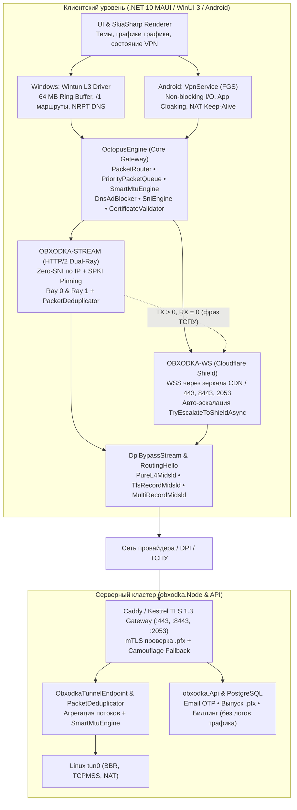

#  Архитектура и спецификация экосистемы Obxodka

Данный документ содержит полное, объективное и детальное техническое описание архитектуры клиентской и серверной частей **Obxodka** — высокоскоростного стелс-VPN нового поколения, разработанного для обхода систем глубокого анализа пакетов (**DPI / ТСПУ**) с нулевыми потерями скорости, ультра-низким игровым пингом (**Dual-Ray Hedging**), кристальной маскировкой под легитимный веб-трафик и строгой политикой **Zero-Log**.

---

##  Актуальная высокоуровневая архитектурная схема (v6.1+)



---

##  1. Клиентская подсистема (Client Architecture)

### 1.1. Платформенный уровень Windows (Wintun Layer 3 Driver)
* **Интерфейс драйвера (`Platforms/Windows/WintunAdapter.cs`):**
  * Прямой P/Invoke к нативной библиотеке `wintun.dll` через `[LibraryImport]` с динамическим разрешением путей через `NativeLibrary.SetDllImportResolver`.
  * Создание адаптера TUN с фиксированным GUID сессии и кольцевым буфером объёмом **64 МБ** (`0x4000000`).
  * Регистрация события готовности пакетов через Win32 API `CreateEvent(IntPtr.Zero, FALSE, FALSE, NULL)`: поток отправки (`SendLoop`) ожидает сигнала ядра без расхода CPU (`WaitHandle.WaitAny` с таймаутом).
  * Чтение входящих пакетов через `WintunReceivePacket`, получение указателя на память и немедленное копирование в `ArrayPool<byte>.Shared` без создания объектов в куче.

* **Сетевая изоляция и маршрутизация (`WindowsVpnService.cs`):**
  * **Охватывающие префиксы (Supernetting /1):** вместо деструктивной перезаписи системного шлюза по умолчанию (`0.0.0.0/0`), Obxodka добавляет два более специфичных маршрута:
    ```cmd
    route add 0.0.0.0 mask 128.0.0.0 100.64.0.1 metric 1
    route add 128.0.0.0 mask 128.0.0.0 100.64.0.1 metric 1
    ```
    Это исключает разрыв базового сетевого стека ОС при сбоях и гарантирует моментальный откат маршрутизации при отключении.
  * **Исключение прямого пути к узлу:** адрес целевого сервера принудительно направляется через физический шлюз (`route add <ServerIp> mask 255.255.255.255 <PhysicalGateway> metric 1`).
  * **Бесшовное отключение без моргания сети (Zero-Flicker Seamless Disconnect):**
    При отключении VPN клиент аккуратно снимает добавленные `/1` маршруты и правила файрвола, не затрагивая глобальные параметры физического адаптера и не вызывая интерфейсный сброс (Interface Reset). Это предотвращает мигание интернета, сброс TCP-сокетов браузера и конфликты с виртуальными адаптерами (Radmin VPN, Hyper-V, WSL).
  * **Защита сессий удаленного доступа (Remote Desktop / LAN Bypass):** сканирование активных подключений RDP (порт 3389), AnyDesk, TeamViewer и локальных подсетей (`10.0.0.0/8`, `172.16.0.0/12`, `192.168.0.0/16`) с автоматическим добавлением `/32` маршрутов в обход VPN, предотвращая потерю удаленного управления машиной.

* **Многоуровневая защита от утечек DNS (Multi-Tier DNS Leak Shield):**
  * **NRPT (Name Resolution Policy Table):** создание групповой политики разрешения имен для корневого пространства `.` с перенаправлением на защищенные VPN-резолверы (`1.1.1.1`, `8.8.8.8`):
    ```powershell
    Add-DnsClientNrptRule -Namespace '.' -NameServers '1.1.1.1','8.8.8.8' -DisplayName 'Obxodka-DNS'
    ```
  * **Блокировка физических портов 53:** брандмауэр Windows жестко блокирует исходящий трафик на 53 UDP/TCP через интерфейсы LAN и Wi-Fi (`Obxodka-DnsLeak-Block-LAN`, `Obxodka-DnsLeak-Block-WiFi`).
  * **Авто-исправление системного DNS (`AutoHealAdapterDnsAsync`):** при сбое или повреждении сторонним софтом локального DNS Obxodka автоматически перенастраивает физические сетевые интерфейсы на доверенный пул (`77.88.8.8`, `1.1.1.1`) и сбрасывает кэш `ipconfig /flushdns`.

* **Бесшовное туннельное переключение (Zero-Handoff Switch):**
  * При смене локации или аварийном переключении узла Wintun-адаптер **не уничтожается**.
  * Физические маршруты перенаправляются на лету на новый IP без сброса сетевого интерфейса ОС, сохраняя активные соединения браузера без фризов.

### 1.2. Платформенный уровень Android (VpnService & Background LifeCycle)
* **Нативная служба (`OctopusVpnService.cs`):**
  * Наследуется от `Android.Net.VpnService`. Запуск в режиме `ForegroundServiceType.TypeSpecialUse` с непрерывным уведомлением в шторке.
  * Конфигурация интерфейса: MTU 1500, назначение IP `100.64.0.2/24`, шлюз `100.64.0.1`, DNS `1.1.1.1` и `8.8.8.8`.
  * Маршрутизация: перехват префиксов `0.0.0.0/1`, `128.0.0.0/1`, `::/1`, `8000::/1`.
* **Высокоскоростной асинхронный I/O:**
  * Дескриптор `ParcelFileDescriptor` оборачивается в нативные `FileInputStream` и `FileOutputStream`.
  * Раздельные выделенные системные потоки чтения (TxThread) и записи (RxThread) обеспечивают независимую обработку двунаправленного трафика.
* **Адаптивный мобильный Keep-Alive:**
  * Первые 30 секунд: частые пинги каждые 500 мс для моментальной калибровки скорости и индикации в UI.
  * Последующая работа: плавный переход на интервал **25 секунд**. Это удерживает трансляцию NAT мобильных операторов и снижает расход заряда батареи радиомодулем на **~90%**.
* **Защита от засыпания (Doze Mode & WakeLock):**
  * Удержание `PowerManager.WakeLockFlags.Partial` только во время активной сессии для предотвращения выгрузки ОС Android.

### 1.3. Интеллектуальный поиск узлов (Happy Eyeballs & Latency Scoring)
* При старте подключения клиент запускает параллельный неблокирующий опрос TCP SYN (`NetworkDefaults.RankServersByLatencyAsync`) по всем доступным серверам кластера (таймаут $650$ мс).
* Серверы ранжируются по взвешенной формуле качества канала:
  $$\text{Score} = \text{RTT}_{\text{ms}} + \frac{\text{LoadPercent}}{5}$$
* Подключение выполняется к быстрейшему стабильному узлу мгновенно без ожидания последовательных таймаутов.

### 1.4. Двухдоменный API Fallback и прямой IP-обход
* Резервирование API-эндпоинтов между зашифрованным пулом доменов-зеркал (`servers.json`).
* При блокировке системного DNS или подмене ответов (DNS Poisoning) клиент автоматически использует прямое подключение по защищенным IP-адресам с ручной эмуляцией заголовков HTTP `Host` и валидацией публичных ключей сертификатов (Certificate Pinning).

---

##  2. Ядро маскировки и транспорт OBXODKA-STREAM

### 2.1. Спецификация бинарного протокола OBXODKA-STREAM
В отличие от тяжеловесного gRPC с накладными расходами сериализации Protobuf, транспорт **OBXODKA-STREAM** работает напрямую поверх полнодуплексного потока HTTP/2 (`PushStreamContent` / `ReadAsStreamAsync`):

* **Формат кадра (ObxodkaFraming):**
  Каждый сетевой пакет Layer 3 или управляющая команда инкапсулируются в компактный бинарный фрейм с маскировкой полей и динамическим зашумлением:
  ```
  +------------------+-------------------+-------------------+--------------------+------------------------+-------------------+
  | Salt (1 байт)    | Total Length      | Payload Length    | Command Code       | Masked Payload         | Random Padding    |
  | (0x00 - 0xFF)    | (2 байта, masked) | (2 байта, masked) | (1 байт, masked)   | (длина: Payload Length)| (динамический шум)|
  +------------------+-------------------+-------------------+--------------------+------------------------+-------------------+
  ```
* **Маскирование полей заголовка:**
  Для предотвращения статического анализа заголовков поля кодируются побитовым XOR с использованием псевдослучайного байта `salt`:
  * `totalMask = 0x7E3A ^ ((salt << 8) | salt)`
  * `payloadMask = 0x4C1F ^ ((salt << 8) | (salt ^ 0x5C))`
  * `cmdMask = 0xA5 ^ salt`
* **Команды управления (Command Codes):**
  * `0x01` (`CmdData`): Сетевой пакет IP-уровня (IPv4 / IPv6);
  * `0x02` (`CmdPing`): Контрольный пинг-запрос (каждые 500 мс);
  * `0x03` (`CmdPong`): Ответ на пинг с меткой времени для расчета RTT;
  * `0x04` (`CmdHandshake`): Клиентское рукопожатие с передачей отпечатка mTLS;
  * `0x05` (`CmdHandshakeResponse`): Ответ сервера с параметрами сессии (выделенный IP, шлюз, DNS);
  * `0x06` (`CmdDisconnect`): Уведомление о штатном разрыве туннеля;
  * `0x07` (`CmdMtuSync`): Двусторонняя синхронизация и фиксация согласованного MTU туннеля.
* **Маскирование полезной нагрузки (Payload Masking):**
  Байты полезной нагрузки маскируются поточным XOR-шифрованием на основе соли и индекса байта:
  $$\text{Payload}[i] \leftarrow \text{Payload}[i] \oplus (\text{salt} + (i \cdot 37) + ((i \gg 3) \oplus 0\text{x}9\text{D}))$$
* **Динамический паддинг (Padding Noise):**
  В хвост кадра добавляется случайное число байт шума из предзаполненного пула памяти, устраняя корреляцию размеров пакетов по длинам характерных сетевых протоколов.

### 2.2. Технология Dual-Ray Hedging (Удвоение лучей для игр)
Сетевые потери в современных сотовых и магистральных сетях носят кратковременный импульсный характер (TCP-реплики, задержка ACK, джиттер очередей ТСПУ). Для пакетов реального времени (онлайн-игры, голосовая связь, системные пинги) задержка ретрансмиссии TCP в 100–300 мс является критической.

**Механизм Dual-Ray Hedging в Obxodka:**
1. **Два независимых физических стрима:** При подключении клиент инициирует два параллельных HTTP/2 соединения: `Ray 0` (порт 443) и `Ray 1` (порт 8443).
2. **Селективное клонирование (`PacketRouter`):**
   * **Realtime UDP (игры, WebRTC) & ICMP:** Клонируются в **оба луча одновременно** (`TxChannels[0]` и `TxChannels[1]`).
   * **TCP Bulk / Web трафик:** Распределяется по лучам в режиме балансировки для максимизации суммарной пропускной способности.
3. **Аппаратный дедупликатор (`PacketDeduplicator`):**
   * Как на клиенте, так и на сервере входящие пакеты поступают в высокопроизводительный `PacketDeduplicator`.
   * Дедупликатор использует кольцевой буфер на 8192 слота со скользящим временным окном **500 мс**.
   * Идентификатор пакета вычисляется на основе 5-Tuple (Src IP, Dst IP, Protocol, Src Port, Dst Port) и контрольной суммы / Sequence Number.
   * Если пакет уже был принят по лучу 0, пришедшая с задержкой в несколько миллисекунд копия по лучу 1 мгновенно отбрасывается **без аллокаций памяти** (`zero-allocation`).
   * **Результат:** 0% потерь пакетов в играх (Dota 2, CS2, Valorant, PUBG, Fortnite, WoT) даже при искусственном троттлинге провайдера.

### 2.3. Адаптивная сегментация TLS (`DpiBypassStream` и `RoutingHello`)
* **Проблема:** Оборудование ТСПУ анализирует первые байты TCP-потока. Обнаруживая целостный TLS `ClientHello` (`0x16 0x03 ... 0x01`), инспектор извлекает SNI и характеристики рукопожатия.
* **Решение:** `RoutingHello` подбирает профиль браузера для очередной попытки подключения (`Chrome`, `Yandex`, `Firefox`, `SafariIos`, `Edge`, `ChromePostQuantum`), а `DpiBypassStream` применяет один из трёх режимов нарезки первого `ClientHello`:
  * `PureL4Midsld` — сегментация TCP-потока на уровне L4 до середины SNI с микро-паузой;
  * `TlsRecordMidsld` — разбиение одиночной TLS-записи на два валидных TLS Record'а;
  * `MultiRecordMidsld` — трёхступенчатая фрагментация TLS Record Layer.

### 2.4. Гибридная стратегия `SniEngine`: `Zero-SNI` + `Cloudflare Shield`
* **Прямой режим (`OBXODKA-STREAM`, Zero-SNI):** При подключении напрямую к IP узла (`DirectServerIp`) отправка SNI в TLS отключается (`EffectiveSni = null`), а серверный сертификат проверяется по жёсткому **SPKI Public Key Pinning** (`DynamicSslPublicKeyHash` + резервные хэши в `AppSecrets`). Перебор портов: `443`, `8443`, `2053`.
* **Облачный режим (`OBXODKA-WS`, Cloudflare Shield):** Для узлов за Cloudflare (`PrimaryDomain` и пул `MirrorDomains` из `servers.json`) клиент подключается по WebSocket поверх TLS с валидным доменом щита на портах `443`, `8443`, `2053` и резервным прямым откатом на `DirectServerIp:443`.
* **Бесшовная эскалация (`TryEscalateToShieldAsync`):** Если прямой поток `OBXODKA-STREAM` упирается в фриз ТСПУ (`TX > 0, RX = 0`), `OctopusEngine` на лету поднимает `ObxodkaWebSocketTransport` через Shield и заменяет транспорт через `Interlocked.Exchange` без пересоздания TUN-интерфейса.

### 2.5. Имитация веб-трафика (Decoy & DoH Anti-Poison)
* **Anti-Poison DNS (`ApiService.ResolveAllHostsAntiPoisonAsync`):** Перед прямыми API-вызовами домены проверяются через шифрованные DoH-резолверы (`DnsDefaults.DohResolvers`), а локальные/заглушечные ответы (`127.x`, `10.x`, `192.168.x`, `100.64.x`) отбрасываются.
* **Ранние браузерные профили:** HTTP/2 и WebSocket-попытки используют заголовки и TLS-профили из `RoutingHello` и чередуют маскировочные пути (`/api/v1/sync`, `/api/v1/stream`, `/v1/telemetry`, `/g/collect`, `/cdn-cgi/rum`, `/v2/event`).

### 2.6. Внутритуннельное адаптивное зондирование MTU (In-Tunnel MTU Discovery)
* **Проблема:** На мобильных сетях (Yota, MegaFon, MTS, Beeline) рукопожатие туннеля проходит успешно (небольшие пакеты <500 байт), но веб-страницы не открываются из-за немого отбрасывания пакетов размером более 1300–1400 байт (Path MTU Black Hole).
* **Решение:**
  * **Базовый безопасный MTU:** 1280 байт (минимальный безопасный размер IPv6 согласно RFC 2460).
  * **Эскалация MTU в туннеле:** Клиент отправляет зондирующие ICMP Echo запросы к шлюзу `100.64.0.1` с возрастающими размерами: `[1240, 1280, 1320, 1360, 1380, 1400, 1420, 1440]` байт.
  * **Синхронизация:** При обнаружении максимального проходящего MTU клиент отправляет кадр `CmdMtuSync`, фиксируя рабочий размер на сервере.
  * **Серверный TCPMSS Clamping:** На сервере действует правило `iptables -t mangle -A FORWARD -p tcp --tcp-flags SYN,RST SYN -j TCPMSS --set-mss 1240`, гарантирующее отсутствие фрагментации TCP-сессий.

---

##  3. Эволюционная ретроспектива: От FECHSUE и gRPC к OBXODKA-STREAM

В истории развития архитектуры Obxodka ключевыми поворотными моментами стали два масштабных рефакторинга:

### 3.1. Урок FECHSUE: Парадокс оверинжиниринга UDP (Коммит `0eab568`)
Изначально в проекте использовался кастомный бинарный протокол **FECHSUE** (Fast Encrypted Chameleon Hybrid Arc Stealth UDP Engine) с аппаратным FEC (Forward Error Correction 4:1 на AVX2/Neon), шейпингом энтропии Шеннона и P2P Mesh Relay на 9656 строк кода.

**Почему FECHSUE оказался заметным для ТСПУ:**
* Попытка замаскировать нестандартный UDP под белый шум привела к тому, что эвристические анализаторы ТСПУ распознавали аномальную энтропию как «неизвестный VPN-протокол».
* В периоды учений РКН глушил весь трансграничный UDP на 80–90%, что сводило на нет любые преимущества FEC.
* **Вывод:** *Лучшая маскировка — это полное растворение в стандартном HTTPS/HTTP/2 трафике.*

### 3.2. Переход от gRPC к OBXODKA-STREAM и Dual-Ray Hedging (Версия 6.0)
После перехода на HTTP/2 ранние версии использовали стандартный gRPC-транспорт. Однако в ходе эксплуатации и тестов на реальных играх были выявлены узкие места:
1. **Protobuf Overhead:** Оборачивание каждого сетевого пакета в gRPC Message создавало избыточные заголовки и накладные расходы на сериализацию.
2. **Head-of-Line Blocking на одном потоке:** При кратковременных просадках TCP-пакетов игра сталкивалась с микро-задержками.

**Решение в OBXODKA-STREAM:**
* Отказ от тяжелого Protobuf в пользу прямого байтового дуплексного стриминга HTTP/2 (`ObxodkaStreamTransport` на клиенте и `ObxodkaTunnelEndpoint` на сервере).
* Внедрение технологии **Dual-Ray Hedging**: два параллельных луча с автоматическим клонированием UDP-гейминга и суб-миллисекундной дедупликацией.
* Результат: идеальная стабильность соединения, пинг на уровне физического канала и нулевой джиттер.

---

##  4. Графическая подсистема SkiaSharp 120 FPS и Living UI Engine

Пользовательский интерфейс Obxodka построен на прямом векторном рендеринге через **SkiaSharp** с аппаратным ускорением на 60 / 120 Гц:

### 4.1. Центральная кнопка подключения: Квантовый Гипер-Кристалл (Hyper-Crystal)
* **Сакральная полигональная геометрия:** 5 концентрических многогранников (4, 5, 6 граней) с различными масштабными коэффициентами (`0.74`, `0.65`, `0.54`, `0.45`, `0.38`), вращающихся во взаимно противоположных направлениях с гармоническими скоростями ($+1.0, -1.0, +1.5, -1.5, +2.0$).
* **3-уровневый Bloom (HDR Neon Glow):**
  1. *Core White:* Центральное сверхъяркое белое ядро;
  2. *Neon Accents:* Контурные линии цвета темы с размытием `SKMaskFilter.CreateBlur(SKBlurStyle.Normal, 8f)`;
  3. *Atmospheric Aura:* Фоновое сферическое свечение с глубоким размытием `24f` и радиальным градиентом, динамически управляемым параметром `ThemeManager.GlowIntensity`.
* **Zero-Allocation Pipeline:** Полное исключение создания объектов в методах отрисовки — кэширование всех `SKPaint`, путей `SKPath` и шейдеров в полях класса.

### 4.2. Энергетическая ударная волна (Shockwave Blast)
* При успешном переходе в статус `Connected` кнопка инициирует расходящуюся волну энергии: 2 концентрических светящихся кольца расширяются от внешнего контура кнопки к границам карточки с затуханием прозрачности и интерполяцией `CubicOut`.
* При отключении (`Disconnected`) воспроизводится волна схлопывания (Implosion Wave) в алом спектре.

### 4.3. Состояние «Connected»: Живой квантовый реактор
* После установления соединения лоадер не угасает, а переходит в режим гармонического дыхания.
* **Интерактивная реакция на сетевой трафик:** скорость медленного орбитального вращения световых фотонных искр и пульсация ауры динамически масштабируются в зависимости от текущей скорости интернета ($\text{SpeedUp} + \text{SpeedDown}$).

---

##  5. Система тем оформления (Theme Ecosystem & Extensibility)

Экосистема тем Obxodka поддерживает богатую кастомизацию интерфейса авторами сообщества через открытый репозиторий [OctoCore-Dev/themes](https://github.com/OctoCore-Dev/themes):

1. **Токены палитры и градиентов (`core.colors`, `core.gradients`):** поддержка статических цветов и `LinearGradientBrush` для кнопок, карточек и графиков.
2. **Неоновый расцвет (`vfx.glow`):** настройка радиуса и интенсивности свечения для киберпанк- и неоновых тем.
3. **9-Slice нарезка рамок (`decorations.screenFrame`, `frameSlice`):** масштабирование сложных текстурных рамок без искажения углов на экранах любого разрешения.
4. **Анимированные кнопки (`buttonVideoIdle`, `buttonVideoActive`):** воспроизведение 60 FPS WebP-анимаций с 8-битным альфа-каналом.
5. **Система частиц (`vfx.particles`):** лепестки сакуры, падающий снег, искры, светлячки с поддержкой пользовательских PNG-спрайтов.

---

##  6. Юридическая документация и диагностика

* **Политика конфиденциальности и No-Logs гарантия:** [PRIVACY_POLICY.md](../PRIVACY_POLICY.md)
* **Пользовательское соглашение и условия использования:** [TERMS_OF_SERVICE.md](../TERMS_OF_SERVICE.md)
* **Политика безопасности и криптографическая спецификация:** [.github/SECURITY.md](../.github/SECURITY.md)
* **Руководство по диагностике и устранению неполадок:** [docs/TROUBLESHOOTING.md](TROUBLESHOOTING.md)
* **Постмортем HTTP/2 Kestrel Stream Abort:** [docs/POSTMORTEM_KESTREL_STREAM_ABORT.md](POSTMORTEM_KESTREL_STREAM_ABORT.md)
* **Журнал блокировок и дайджест ТСПУ:** [docs/BLOCKING_DIGEST.md](BLOCKING_DIGEST.md)
* **История версий и изменений:** [CHANGELOG.md](../CHANGELOG.md)
* **Создание и публикация тем оформления:** [GitHub Wiki: themes](https://github.com/OctoCore-Dev/themes/wiki)
